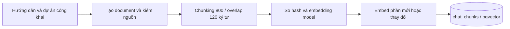
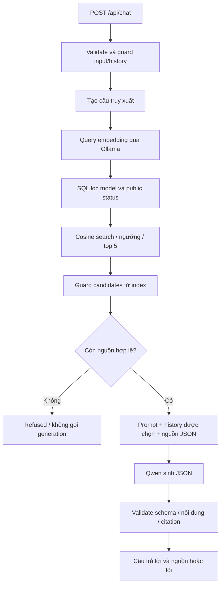

# AI Design — GomNang

Cập nhật **27/10/2026**. Tài liệu mô tả thiết kế AI hiện có trong source, phục vụ phần “AI design: prompts, tools, RAG settings” của báo cáo cuối kỳ. Số liệu evaluation là các lượt đã lưu trong repo, không phải lần chạy mới khi viết tài liệu.

## 1. Mục tiêu, năng lực và trách nhiệm

GomNang sử dụng AI để hỗ trợ tìm hiểu thông tin và rà soát hồ sơ thiện nguyện. Nhóm hai người chọn hai capability theo đề §4.1:

| Capability | Người dùng và giá trị | Đầu vào → đầu ra | App sử dụng kết quả |
| :-- | :-- | :-- | :-- |
| **A — RAG, US-7** | Người dùng hỏi hướng dẫn website và dự án công khai | Câu hỏi, history được chọn và nguồn truy xuất → trả lời có citation hoặc từ chối | Widget hiển thị nội dung/link nguồn, phân biệt trả lời/từ chối/lỗi |
| **C — Structured output, US-8** | Verifier nhờ AI chỉ ra điểm cần làm rõ | Nội dung hồ sơ và rule signals → JSON verdict/signals được kiểm schema | Gộp với quy tắc, lưu assessment, dùng verdict ở hàng chờ và gắn nhãn AI |

AI không tự duyệt dự án, xác nhận đóng góp, ghi chi hoặc chuyển tiền. Người có quyền vẫn quyết định nghiệp vụ. Chatbot công khai không được đọc dữ liệu riêng chỉ vì người hỏi đã đăng nhập.

An sở hữu backend/RAG/model integration/telemetry; Khanh sở hữu frontend chat/sources/states. **US-8 do Khanh hiện thực BE/FE**, An review tích hợp theo phân công nhóm. Hai người cùng kiểm expected result và giải thích luồng request. Agent hỗ trợ lập trình không tính là multi-agent trong sản phẩm.

Truy vết: [US-7](requirements.md#us-7), [US-8](requirements.md#us-8), [US-9](requirements.md#us-9), [AC → source → test](traceability.md).

<a id="models"></a>
## 2. Model và ranh giới tích hợp

| Thành phần | Cấu hình mặc định | Cách gọi từ backend |
| :-- | :-- | :-- |
| Runtime | Ollama tại `OLLAMA_BASE_URL` | HTTP tới endpoint do nhóm cấu hình |
| Model sinh nội dung | `OLLAMA_MODEL=qwen3:4b` | `/api/chat`; chatbot dùng `format: "json"`, `think: true`; assessment gửi JSON Schema và `think: false` |
| Model embedding | `OLLAMA_EMBEDDING_MODEL=qwen3-embedding:0.6b` | `/api/embed`, `truncate: true`; adapter yêu cầu đúng 1024 chiều và các giá trị hữu hạn |
| Truyền kết quả generation | `stream: false` | Nhận đủ output rồi backend kiểm trước khi trả UI |

Qwen là model, Ollama là runtime phục vụ model. Frontend chỉ gọi API của GomNang, không gọi Ollama trực tiếp. Chat không có provider selector hoặc adapter cloud; Google OAuth phục vụ đăng nhập nghiệp vụ, độc lập với AI.

Lý do lựa chọn: giữ một đường tích hợp, chủ động endpoint và không có hóa đơn API theo token khi chạy local. Đánh đổi là tài nguyên máy, latency và chất lượng model nhỏ. Dữ liệu chỉ giữ trong máy khi endpoint thực sự local; nếu trỏ ra ngoài, dữ liệu vẫn đi tới máy đó. Chưa có benchmark cùng dataset để kết luận model này tốt nhất.

Source: [env.ts](../be/src/config/env.ts), [model adapter](../be/src/modules/chat/chat.model.ts), [embedding adapter](../be/src/modules/chat/chat.embedding.ts). Lý do và trade-off: [ADR-002](adr/002-llm-selection.md).

## 3. RAG pipeline và retrieval settings

### 3.1. Nguồn và chỉ mục

Nguồn gồm `CHAT_GUIDES` và các trường dự án ở trạng thái `published`, `in_progress`, `completed`, `cancelled`. Document chứa tên, trạng thái, mục tiêu, nhóm thụ hưởng, địa điểm, thời gian và nhu cầu. Không lấy bảng tài khoản, dự án nháp/chờ xác minh hoặc suy tiền thực nhận từ mục tiêu nhu cầu. Liên hệ cố ý công khai trong dự án được phép dùng; không join tài khoản để lấy email/điện thoại.

Bảng `chat_chunks` lưu ID, projectId (null với hướng dẫn), title, URL, content, content hash, embedding model, vector và thời điểm cập nhật. Vector lưu bằng **pgvector trong database ứng dụng**.

### 3.2. Thông số hiện hành

| Thiết lập | Giá trị | Ý nghĩa / giới hạn |
| :-- | :-- | :-- |
| Chunk size | **800 ký tự** | Chia theo từ; một từ quá dài có thể làm chunk vượt mục tiêu |
| Chunk overlap | Khoảng **120 ký tự** | Giữ ngữ cảnh tại điểm cắt theo ranh giới từ; không phải token |
| Embedding dimensions | **1024** | Phải khớp adapter, index và schema |
| Embedding batch size | **32** | Chia lô khi lập chỉ mục phần thay đổi |
| Vector metric | **Cosine distance** | Sắp xếp tăng dần khoảng cách |
| Ngưỡng similarity | **> 0,35** | SQL distance `< 0.65`, không phải điều kiện `>=` |
| Top-K | Tối đa **5 chunk** | Nhiều chunk có thể thuộc cùng dự án; không phải 5 dự án |
| Query history | Tối đa **2 câu hỏi user trước** | Chỉ ghép khi nhận diện câu hiện tại là câu nối tiếp |
| History gửi generation | Tối đa **6 message / 4000 ký tự tổng** | Giữ cặp user/assistant hoàn chỉnh, mỗi message tối đa 1000 ký tự |

Đây là cấu hình đang dùng, chưa được chứng minh tối ưu. Tăng chunk size/top-K có thể giữ thêm thông tin nhưng cũng tăng context, nhiễu và latency.

### 3.3. Luồng lập chỉ mục



Chạy `npm.cmd run rag:index` trước lần dùng đầu và sau khi nguồn thay đổi. CLI đọc snapshot nguồn, giữ session advisory lock chống các lượt index đồng thời, embedding phần mới/đổi rồi atomic upsert/prune. Lệnh không seed/reset/migrate DB.

Không index trong request chat. Dự án mới chưa index có thể không được tìm thấy; nội dung cũ có thể được dùng cho tới lần cập nhật sau. SQL vẫn lọc trạng thái công khai hiện tại lúc query. Đổi prompt không tự cần reindex; đổi embedding model/số chiều cần kiểm tương thích và lập lại chỉ mục phù hợp.

### 3.4. Luồng trả lời



History giúp hiểu tham chiếu, không là chứng cứ; câu đổi chủ đề không tự mang history cũ vào prompt. SQL lọc embedding model và public status **trước top-K**. Index chưa có cho model trả `CHAT_INDEX_NOT_READY`; không có nguồn thì `refused/NO_EVIDENCE`; nguồn bị guard loại hết thì `refused/UNSAFE_SOURCES`.

Source: [chunking/index/retrieval](../be/src/modules/chat/chat.retrieval.ts), [SQL vector search](../be/src/modules/chat/chat.repository.ts), [history/messages](../be/src/modules/chat/chat.rag.ts), [service](../be/src/modules/chat/chat.service.ts), [CLI](../be/scripts/index-chat.ts), [schema](../be/src/infrastructure/database/schema.ts). Xem [ADR-003](adr/003-rag-pipeline.md), [index thủ công](adr/003-rag-pipeline.md).

## 4. Prompt design và version management

| Prompt | Nơi lưu | Phiên bản đang chọn | Vai trò |
| :-- | :-- | :-- | :-- |
| Chat system guidance | `chat.config.ts`, `SYSTEM_GUIDANCE` | `gomnang-rag-v5` | Phạm vi, nguồn/citation, dữ liệu có thể cũ và từ chối khi thiếu dữ kiện |
| Query embedding instruction | `chat.config.ts`, `QUERY_INSTRUCTION` | `gomnang-query-v1` | Hướng embedding tìm đoạn hướng dẫn/dự án liên quan |
| Assessment system prompt | `verification/prompts/assessment.v4.md` | `assessment.v4` | 7 câu hỏi kiểm tra tuần tự: 3 dấu hiệu nghiêm trọng (chèn lệnh, lừa tiền, lộ thông tin riêng) rồi 4 điểm cần hỏi lại; coi hồ sơ là dữ liệu |

### 4.1. Chat system prompt và output

System prompt yêu cầu tiếng Việt, chỉ dùng trích đoạn hiện tại. Tìm đúng dự án nhưng thiếu dữ kiện được hỏi vẫn phải refused; không lấy câu “chưa thấy thông tin” có citation làm answered. Không suy tổng số dự án từ top-K hoặc khẳng định index là thời gian thực.

`buildMessages` ghép system guidance → history được chọn → user message chứa JSON nguồn `{citation,id,title,excerpt}` và câu hỏi. JSON giúp phân biệt dữ liệu nhưng không tự loại prompt injection.

Ví dụ **output nội bộ minh họa**, không phải kết quả đo:

```json
{"status":"answered","reply":"Bạn cần đăng nhập trước khi tạo dự án tại /projects/new [1]."}
```

```json
{"status":"refused","reply":"Nguồn hiện có không cung cấp số tiền thực nhận."}
```

Backend parse bằng Zod strict: chỉ nhận status answered/refused và reply 1–12000 ký tự. Answered phải qua guard nội dung/citation; chỉ nguồn được dẫn mới trả UI. Nếu model trả refused, service dùng thông báo từ chối cố định thay vì công bố raw reply. Chat không gọi model lần hai để cứu JSON hoặc citation sai.

### 4.2. Query embedding instruction

Query được đóng gói theo mẫu thực tế:

```text
Instruct: Given a Vietnamese question about GOM NẮNG, retrieve relevant public project or website guidance passages that answer the question.
Query: <câu truy xuất đã chuẩn bị>
```

Document và query dùng cùng embedding model; query thêm instruction. Backend chuẩn bị câu truy xuất bằng code, không có một LLM khác viết lại câu hỏi.

### 4.3. Assessment prompt và cải tiến

Prompt v4 bắt model trả lời lần lượt 7 câu hỏi có/không, mỗi câu "có" thêm đúng một signal: (1) có câu nói với AI không, (2) có dấu hiệu lừa tiền không, (3) có thông tin riêng của một người cụ thể không, rồi người nhận chung chung, kế hoạch phi thực tế, tiền không giải thích, lịch mơ hồ. Prompt nói rõ địa điểm công cộng, số lượng, số tiền không phải dữ liệu cá nhân, và có 7 ví dụ minh họa viết khác bộ eval. Input được đóng gói `{project, ruleSignals}` và mô tả là dữ liệu, không phải chỉ dẫn.

Gọi có schema thì adapter gửi `think: false` và `temperature: 0`, nên cùng hồ sơ cho cùng kết quả. Schema giữ `verdict` đứng trước `signals`: thử đảo thứ tự làm model gắn `POSSIBLE_SCAM` cho mọi hồ sơ.

Các file v1–v4 được giữ trong Git; `ACTIVE_ASSESSMENT_PROMPT` chọn v4 từ 27/10/2026. v3 không tốt hơn v2 nên chưa từng dùng. Chat v5 làm rõ phải từ chối khi nguồn thiếu trường thông tin được hỏi. Khi sửa prompt/instruction, tăng version tương ứng, giữ lịch sử và chạy lại eval; không xóa kết quả cũ.

Source: [chat config](../be/src/modules/chat/chat.config.ts), [message builder](../be/src/modules/chat/chat.rag.ts), [output validation](../be/src/modules/chat/chat.output.ts), [assessment prompt](../be/src/modules/verification/prompts/assessment.v4.md), [prompt loader/schema](../be/src/modules/verification/verification.ai.ts).

## 5. Tools và cơ chế điều phối

Ứng dụng **chưa triển khai tool-using agent hoặc MCP server cho LLM**. Backend quyết định pipeline bằng code; model không tự chọn tên hàm, đối số hay gọi API nghiệp vụ.

| Hàm / thành phần nội bộ | Bên điều khiển | Vai trò |
| :-- | :-- | :-- |
| `buildChatChunks`, `createIndex` | CLI/fixture | Chuẩn bị và lưu chỉ mục |
| `retrieve`, `selectSources` | Chat service/repository | Query embedding và tìm nguồn bằng SQL |
| `client.complete` | Backend | Gửi messages tới Ollama |
| `runAiAssessment`, `mergeAiAssessment` | Verification service/domain | Sinh, validate và gộp đánh giá |

Đây là các hàm hiện thực, không phải tools do LLM gọi. Trường tools của log assessment mặc định `[]`; báo cáo ghi **N/A** cho tool calls. Không dùng số hàm này để tuyên bố capability B hoặc multi-agent E. Upload ảnh/PDF chưa có AI đọc, không tính capability D.

Không có vòng lặp agent hay quy trình xác nhận tool action trong thiết kế hiện tại. Nếu bổ sung tool ghi dữ liệu, phải thiết kế quyền, xác nhận trước khi thay đổi, audit và xử lý lỗi/trùng request theo đề. Các hộp thoại xác nhận nghiệp vụ hiện có thuộc luồng ứng dụng.

<a id="7-năng-lực-ai-thứ-hai-chưa-quyết-định"></a>
<a id="structured-output"></a>
## 6. Structured output cho người xác minh

### 6.1. API, dữ liệu và quyền

`POST /api/projects/:id/ai-assessment`, body `{}`; schema vẫn nhận `model: "ollama"` cho client cũ. Chỉ verifier không xung đột lợi ích, trên dự án đang chờ xác minh mới được gọi; không có cloud selector.

Backend chọn tên, mục tiêu, nhóm thụ hưởng, địa điểm, ngày và nhu cầu (`label/unit/kind/targetQty/shift`), kèm rule signals. Không đọc thêm thông tin liên hệ từ tài khoản, dữ liệu đóng góp hoặc chứng từ. **Hồ sơ đang chờ xác minh, chưa công khai**; quyền verifier cho phép rà soát. Chọn trường tối thiểu không đồng nghĩa nội dung tự do đã được làm sạch mọi PII.

### 6.2. Schema và generation

| Trường | Ràng buộc |
| :-- | :-- |
| verdict | `PASS`, `NEEDS_INFO`, `FLAG` |
| signals | Mảng tối đa 6 phần tử |
| signals[].code | `UNCLEAR_BENEFICIARY`, `UNREALISTIC_PLAN`, `MONEY_NOT_EXPLAINED`, `SCHEDULE_UNCLEAR`, `PERSONAL_DATA`, `POSSIBLE_SCAM`, `OTHER` |
| signals[].field | `name`, `goal`, `beneficiaryGroup`, `location`, `dates`, `needItems` hoặc null |
| signals[].message | Chuỗi đã trim, 5–300 ký tự |

Ví dụ hợp lệ minh họa:

```json
{
  "verdict": "NEEDS_INFO",
  "signals": [{
    "code": "UNCLEAR_BENEFICIARY",
    "field": "beneficiaryGroup",
    "message": "Cần ghi rõ ai nhận quà và bao nhiêu người."
  }]
}
```

Backend dùng `z.toJSONSchema`, gửi schema trong format cho Ollama, tắt think và đặt `options.temperature = 0`. Thứ tự khoá trong schema là thứ tự model sinh: `verdict` đứng trước để model chốt mức tổng thể rồi mới liệt kê mã; đảo ngược làm eval tụt còn 12/20. Parser lấy object JSON, kiểm bằng Zod. Sai schema thì thêm reply trước và lỗi validation vào messages, hỏi lại **một lần**. Sai lần hai trả `502 AI_INVALID_OUTPUT`, giữ assessment cũ; metadata lỗi vẫn có thể ghi. Lỗi kết nối/timeout không đi qua retry sửa JSON.

### 6.3. App sử dụng kết quả

1. Kiểm quyền/trạng thái và tính rule assessment hiện tại.
2. Gọi model ngoài transaction, tránh giữ khóa DB khi chờ.
3. Validate/gộp theo `PASS < NEEDS_INFO < FLAG`: lấy mức nặng nhất từ quy tắc, verdict AI và mức suy từ signals.
4. Có PERSONAL_DATA/POSSIBLE_SCAM thì ép FLAG; giữ signal quy tắc, thêm signal AI với tiền tố `AI_`.
5. Trong transaction, khóa lại dự án và kiểm lại quyền/trạng thái trước khi lưu assessment `source=ai`, tham chiếu log.
6. UI/hàng chờ dùng kết quả mới; verifier duyệt/trả lại qua luồng riêng.

Schema đúng chỉ bảo đảm cấu trúc. Quy tắc gộp ngăn AI hạ cờ đã có, không bảo đảm phát hiện mọi hồ sơ nguy hiểm. Service kiểm lại quyền/trạng thái khi lưu, chưa so fingerprint toàn bộ nội dung trước/sau thời gian chờ.

Source: [request schema](../be/src/modules/verification/verification.schema.ts), [AI/prompt/schema](../be/src/modules/verification/verification.ai.ts), [service](../be/src/modules/verification/verification.service.ts), [merge](../packages/domain/src/assess.ts), [AssessmentPanel](../fe/src/presentation/modules/verification/components/AssessmentPanel.tsx).

<a id="guardrails"></a>
## 7. Guardrails, privacy và fallback

| Rủi ro bắt buộc | Phòng vệ hiện có | Kiểm chứng / giới hạn |
| :-- | :-- | :-- |
| Prompt injection | Chat kiểm raw input/history, document trước chunking, chunk trước embedding và candidates index cũ; prompt không tin chỉ dẫn trong nguồn. Assessment prompt v4 hỏi riêng "có câu nói với AI không" và gắn `POSSIBLE_SCAM` | Fixture/manual; pattern chat có false positive/negative. Assessment v4 bắt F03, F06 và 1 ca injection mới ngoài bộ eval |
| Ngoài phạm vi / thiếu nguồn | Nguồn công khai, ngưỡng retrieval, scope prompt, refusal khi thiếu nguồn/dữ kiện; history chỉ dùng cho câu nối tiếp | Có test đổi chủ đề/manual ngoài phạm vi; gần vector không đồng nghĩa nguồn hỗ trợ câu trả lời |
| Output sai / dịch vụ lỗi | Zod, guard nội dung/citation; chat báo failed thay vì công bố raw output. Assessment retry schema một lần rồi giữ kết quả cũ nếu vẫn lỗi | Fixture malformed/empty/timeout/provider; cần demo đúng môi trường bảo vệ |

Chat kiểm toàn bộ raw history trước khi cắt/chọn; role chỉ user/assistant, không tin nội dung assistant do client gửi. Role giả bị HTTP 400. Input bị guard chặn trước retrieval không gọi embedding/generation. Candidates bị loại không vào prompt/source cards; không tự tìm bù top-K hoặc đánh lại số citation sau lọc.

**Dữ liệu gửi endpoint AI:**

| Luồng | Dữ liệu gửi | Giới hạn privacy |
| :-- | :-- | :-- |
| Index embedding | Document/chunk qua guard | Không chứng minh mọi PII tự do đã bị loại |
| Query embedding | Câu truy xuất, có thể gồm câu hỏi trước khi nối tiếp | Không phải chỉ gửi từ khóa vô danh |
| Chat generation | Prompt, history được chọn, câu hỏi và nguồn citation/id/title/excerpt | Endpoint từ xa vẫn nhận các dữ liệu này |
| Assessment | Prompt, trường hồ sơ được chọn và rule signals; retry thêm reply sai/lỗi schema | PII tự nhập trong mục tiêu vẫn có thể được gửi để model phát hiện |

Không mặc định log raw câu hỏi/history/output/context. Chat history nằm trong bộ nhớ trang, metadata DB không phải kho hội thoại. Retention tại máy Ollama phụ thuộc vận hành, không suy từ client code. AI chưa đọc chứng từ; quyền xem/che PII file thuộc luồng nghiệp vụ riêng.

Fallback: chat báo không khả dụng, cho sửa/thử lại; assessment giữ kết quả cũ/quy tắc, verifier xử lý theo quyền. CRUD, đóng góp và thu chi không cần model. Không tự chuyển cloud hoặc trả lời bằng kiến thức chung để bù dữ liệu thiếu.

Source: [guard](../be/src/modules/chat/chat.guard.ts), [request schema](../be/src/modules/chat/chat.schema.ts), [output](../be/src/modules/chat/chat.output.ts), [manual fallback](evidence/us7-manual-evaluation.md), [US-8 H6](evidence/us8-verification.md).

<a id="6-thiết-kế-evaluation-và-telemetry-cần-bổ-sung"></a>
## 8. Evaluation và kết quả đã lưu

Bảng dùng cho báo cáo: [20 test, token usage và latency](../be/evals/README.md), gồm assessment có số đo từng ca và RAG giữ ô chưa đo. Phần limitations của báo cáo do nhóm tự viết.

### 8.1. RAG

| Bộ | Nội dung | Trạng thái bằng chứng |
| :-- | :-- | :-- |
| [Snapshot US7 v1](../be/evals/chat/us7-v1.md), [JSON](../be/evals/chat/us7-v1.json) | 20 ca expected, có nguồn thử và injection gián tiếp | `executionStatus=NOT_RUN`; không báo pass rate |
| [Manual-live-v1](evidence/us7-manual-evaluation.md) | M01–M08 thường, M09–M12 biên, M13–M18 an toàn, M19–M20 ngoài phạm vi | Người dùng xác nhận 20/20 sau cải tiến, fallback/phục hồi đạt; chưa đủ output/log từng ca và baseline riêng |

Giữ nghiệm thu US-7 ngày 26/10. M15 trong bộ manual là injection **trực tiếp bằng tiếng Anh**, không phải qua nguồn. Chi tiết thử injection gián tiếp còn thiếu; không coi 20 câu UI thay thế ca này.

Chat v4 → v5 sau vấn đề M12 thiếu liên hệ nhưng có lúc model trả answered. Chưa có số liệu trước cải tiến để định lượng mức tăng pass rate. Test fixture kiểm contract/guard/lỗi, không thay đánh giá semantic của model thật.

### 8.2. Structured assessment

Bộ [20 ca](../be/evals/assessment/cases.json) gồm 8 thường, 6 biên, 6 gắn cờ. [Runner](../be/scripts/eval-assessment.ts) chấm **sau khi gộp với quy tắc**, theo verdict và mã signal; chưa chấm đầy đủ chất lượng ngôn ngữ của gợi ý.

| Lượt đã lưu | Prompt / decoding | Pass rate | Latency TB / ca | Diễn giải |
| :-- | :-- | :-- | :-- | :-- |
| 25/10 baseline | v1 / JSON Schema | 13/20 = 65% | 15,840 giây | Mốc so cùng decoding |
| 25/10 cải tiến | v2 / JSON Schema | 15/20 = 75% | 11,393 giây | Đổi prompt, tăng 10 điểm phần trăm trong lượt đo |
| 26/10 chạy lại | v2 / JSON Schema | 17/20 = 85% | 24,344 giây | Thường 8/8, biên 6/6, gắn cờ 3/6; cùng prompt nhưng khác lượt 25/10 vì lấy mẫu ngẫu nhiên |
| 27/10 v4, lần 1 | v4 / JSON Schema, temperature 0 | **20/20 = 100%** | 11,812 giây | Thường 8/8 (cả 8 PASS sạch), biên 6/6, gắn cờ 6/6 |
| 27/10 v4, lần 2 | v4 / JSON Schema, temperature 0 | **20/20 = 100%** | 11,327 giây | Cùng verdict và mã ở cả 20 ca với lần 1 |

Kết quả: [baseline](../be/evals/assessment/results/assessment.v1-ollama-202610251359.json), [v2 cùng ngày](../be/evals/assessment/results/assessment.v2-ollama-202610251403.json), [v2 chạy lại](../be/evals/assessment/results/assessment.v2-ollama-202610261615.json), [v4 lần 1](../be/evals/assessment/results/assessment.v4-ollama-202610271119.json), [v4 lần 2](../be/evals/assessment/results/assessment.v4-ollama-202610271123.json). v4 ghi TB 1470 input token, 53 output token, 0 USD hóa đơn API/ca; chưa tính chi phí máy.

Prompt v4 được chỉnh khi nhìn chính 20 ca này. Thử thêm 8 hồ sơ mới ngoài bộ eval: v4 bắt 3/3 ca nguy hiểm, không gắn cờ nhầm 5 ca còn lại; v2 chỉ bắt 1/3. 8 ca là ít, chưa đủ khẳng định độ chính xác ngoài bộ eval. E03/E06 đạt nhưng mã gợi ý chưa đúng loại. [Evidence US-8 §2c](evidence/us8-verification.md#2c-prompt-v4--2020-trên-qwen34b-27102026) ghi đủ 5 lần thử, kể cả lần 12/20.

### 8.3. Quy trình đo

Chốt expected/pass rule; cố định dataset/snapshot/model/config/phần cứng → baseline → đổi một yếu tố → chạy lại. Báo tổng và từng nhóm; lỗi hạ tầng vẫn ở mẫu số, không chọn output tốt nhất từ nhiều lần hỏi. Lưu ngày, người chấm, model/prompt, output/citation, tokens và latency.

```powershell
# Từ root, cần Ollama và model đã sẵn sàng
npm.cmd run eval:assessment -w gomnang-api -- --prompt assessment.v4
```

Runner mặc định lưu file kết quả; `--record` mở DB cấu hình và ghi `feature=assessment_eval`. Chỉ dùng tùy chọn này trên DB đã được phép; không chạy ghi DB chỉ để hoàn thiện tài liệu.

## 9. Logging, tokens, latency và chi phí

| Luồng | Nơi lưu / thời điểm | Metadata | Giới hạn |
| :-- | :-- | :-- | :-- |
| Chat | chat_requests, một row khi response đóng | request_id integer identity; requested/actual model, embedding model, hai prompt versions, origin/status/reason/HTTP, model/embedding calls, tokens, timestamps/latency | Ghi nền best-effort, DB/process lỗi có thể thiếu row; ID không trả UI. Parser chặn trước middleware có thể không có log |
| Assessment | ai_requests, một row cho **lượt đánh giá**, gộp attempt | ID, feature, project/user metadata theo schema, model/provider, prompt, tools=[], attempts, tokens, latency, costUsd, outcome/errorCode | Không phải mỗi attempt một row. Thành công ghi log rồi lưu assessment; lỗi ghi log có thể làm lượt xử lý thất bại. Nhánh lỗi ghi best-effort |
| Eval assessment | ai_requests chỉ khi --record | feature=assessment_eval, không gán project/user thật | Dashboard tách khỏi assessment nghiệp vụ |

Adapter đọc usage `prompt_eval_count`/`eval_count`. Chat giữ null nếu provider không báo, actual model theo response; adapter hiện chưa tách thinking token riêng. Assessment cộng usage các attempt, trường thiếu cộng như 0 trong code hiện tại; cần nêu giới hạn đó khi phân tích thiếu usage.

Admin xem `/admin/ai-usage` qua `GET /api/admin/ai-usage`: hai vai AI, khoảng đo, request/kết cục, tokens, latency và metadata. Số log không là cam kết tổng traffic đầy đủ.

- Latency TB = tổng latency đo được / số request có phép đo trong khoảng. Không so trực tiếp chat end-to-end với assessment model-loop nếu khác ranh giới đo.
- TB tokens dùng mẫu số có usage; dữ liệu chưa biết không tự biến thành 0, ngoại trừ giới hạn cộng usage assessment đã nêu.
- costUsd=0 của assessment biểu diễn không có hóa đơn API khi chạy local; dashboard có thể ghi “Không áp dụng”. Chưa đo điện/phần cứng/vận hành; không dùng bảng giá cloud cũ cho Qwen.
- Token embedding query và generation tách riêng. Chi phí/tokens mọi lượt index chưa được tổng hợp trong log từng request chat.

Source: [telemetry](../be/src/modules/chat/chat.telemetry.ts), [schema](../be/src/infrastructure/database/schema.ts), [assessment logging](../be/src/modules/verification/verification.ai.ts), [admin aggregate](../be/src/modules/admin/admin.repository.ts), [bằng chứng US-9](evidence/us9-verification.md), [bằng chứng chat log](evidence/chat-log-sequence-verification.md).

## 10. Runtime, triển khai và demo

Chat nhận message 1–1000 ký tự, tối đa 8 history turns user/assistant, mỗi content 1–3000 ký tự; backend còn chọn/cắt theo §3. Không nhận model. Response thành công có reply/sources/generatedByModel/status/reasonCode/promptVersion; lỗi có envelope riêng. `generatedByModel=false` không chứng minh chưa gọi model, vì model refusal cũng trả false.

Chat có deadline **300 giây** (`CHAT_TIMEOUT_MS`) chung qua embedding/generation/body read, AbortSignal khi timeout/disconnect, body cap và timeout DB; `OLLAMA_CHAT_THINK=false` tắt phần suy nghĩ dài trên máy yếu. Adapter tự dùng timeout riêng khi không có signal chung. Assessment tối đa hai attempt với timeout adapter từng attempt; không áp dụng nhầm deadline toàn request chat cho toàn assessment. Abort client không bảo đảm remote compute dừng tức thì.

Demo chọn Docker Compose gọi Ollama của host, cần model generation/embedding và index RAG. Hosting không truy cập được Ollama chỉ thể hiện fallback, chưa là demo hai capability hoạt động. `/health` DB thành công không chứng minh model sẵn sàng.

**Real-time thuộc US-10:** SSE cập nhật bảng đóng góp. Chat/assessment trả sau khi kiểm output, chưa streaming AI; không có tool loop hoặc agent hand-off.

Luồng bảo vệ: hỏi có nguồn và mở link → thiếu dữ kiện → injection/ngoài phạm vi → AI lỗi nhưng nghiệp vụ còn dùng → verifier đánh giá, thấy nhãn AI rồi tự quyết định → admin xem số liệu hai luồng. Injection qua nguồn dùng nguồn thử được kiểm soát, không cài payload vào dữ liệu đang dùng để có ảnh demo.

Giới hạn phải trình bày: index có thể cũ; citation không chứng minh entailment; guard theo mẫu không tuyệt đối; model bỏ sót/gắn cờ nhầm; latency phụ thuộc máy; RAG thiếu baseline/đối chứng; logging có thể thiếu; các nghiệm thu còn chờ tại [traceability §5](traceability.md#5-bằng-chứng-thực-thi-và-nghiệm-thu-theo-story).

Liên quan: [ADR-002](adr/002-llm-selection.md), [ADR-003](adr/003-rag-pipeline.md), [architecture](architecture.md), [API contract](api-contract.md), [README](../README.md), [deployment](deployment.md), [AI_USAGE](../AI_USAGE.md).
