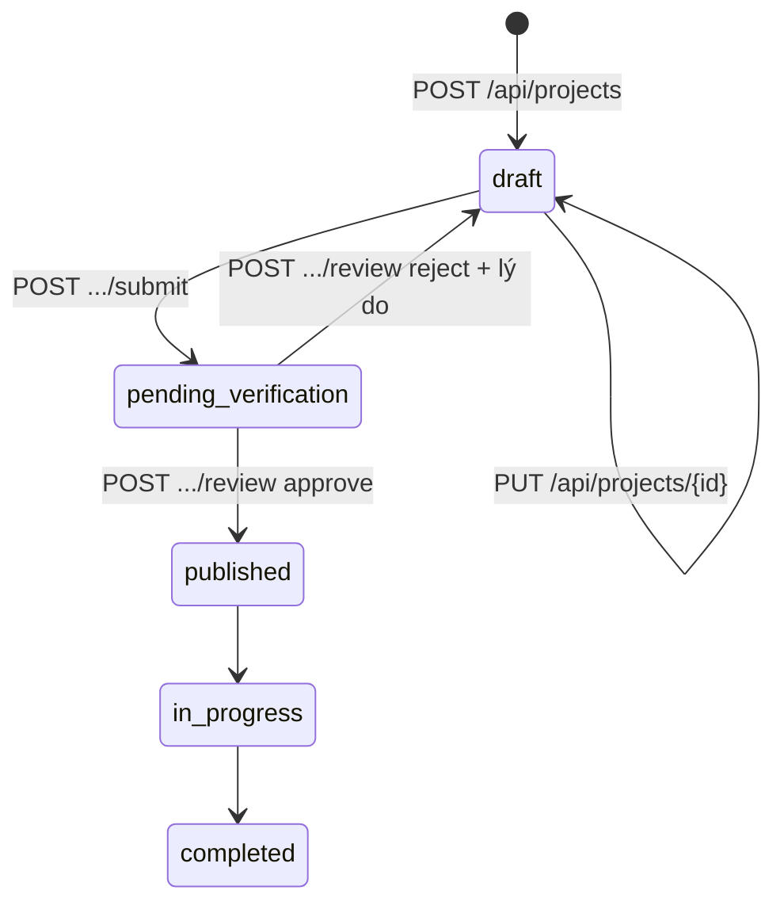

# API contract — GOM NẮNG

Hợp đồng giữa frontend (`apps/web`) và backend (`apps/api`). Kiểu dữ liệu chính xác nằm ở [`packages/domain/src/types.ts`](../packages/domain/src/types.ts) — cả hai phía import cùng một file đó, nên lệch hợp đồng là lỗi biên dịch chứ không phải lỗi lúc chạy.

- **Backend thật** hiện thực toàn bộ contract này: [`apps/api/src/routes.ts`](../apps/api/src/routes.ts).
- **Mock của frontend** hiện thực y hệt, cùng mã HTTP và mã lỗi: [`apps/web/lib/api.ts`](../apps/web/lib/api.ts).

> Mọi ví dụ request/response dưới đây được **ghi lại từ server thật** ngày 2026-09-14 bằng `curl`, không viết tay. Mã `id` sinh ngẫu nhiên nên sẽ khác khi bạn chạy lại. Một số response dài được rút gọn — chỗ rút gọn có ghi rõ.

---

## 1. Quy ước chung

| Mục | Quy ước |
| :-- | :-- |
| Base URL | `http://localhost:4000` khi chạy local |
| Định dạng | JSON, UTF-8. Header `content-type: application/json` |
| Xác thực | `Authorization: Bearer <token>`. Token là JWT ký HS256, hạn 8 giờ |
| Lấy token | `POST /api/auth/dev-login` — chỉ có khi `ENABLE_DEV_LOGIN=true`, **luôn tắt khi `NODE_ENV=production`** |
| Ngày | `YYYY-MM-DD`, tính theo giờ Việt Nam |
| Thời điểm | ISO 8601 theo UTC, ví dụ `2026-09-14T13:26:01.873Z` |
| Truy vết | Mỗi response có header `x-request-id`, trùng với `requestId` trong log server |
| Kích thước body | Tối đa 100 KB |

### Hình dạng lỗi

Mọi lỗi đều có cùng một hình dạng. `details` chỉ có khi lỗi gắn với từng trường cụ thể.

```json
{
  "error": {
    "code": "VALIDATION_FAILED",
    "message": "Dữ liệu dự án chưa hợp lệ.",
    "details": { "treasurerId": "BR-003: ..." }
  }
}
```

Client nên rẽ nhánh theo `code`, không theo `message` — `message` là chữ cho người đọc và có thể đổi.

## 2. Chính sách mã trạng thái

| Mã | Dùng khi | `code` có thể gặp |
| :-- | :-- | :-- |
| **200** | Đọc thành công, hoặc đổi trạng thái thành công | — |
| **201** | Tạo mới thành công. Tạo dự án thì kèm header `Location` | — |
| **400** | Request **sai định dạng**: thiếu trường, sai kiểu, ngày sai dạng, JSON hỏng, chuỗi quá dài | `BAD_REQUEST`, `MALFORMED_JSON` |
| **401** | Chưa đăng nhập, hoặc token sai / hết hạn | `AUTH_REQUIRED`, `INVALID_TOKEN` |
| **403** | Biết bạn là ai, nhưng **bạn không có quyền** làm việc này | `NOT_VERIFIER`, `NOT_COORDINATOR`, `CONFLICT_OF_INTEREST`, `SELF_CONFIRMATION`, `MONEY_NEEDS_COORDINATOR`, `NOT_ALLOWED` |
| **404** | Không tồn tại — **hoặc tồn tại nhưng bạn không được phép biết** | `PROJECT_NOT_FOUND`, `NEED_NOT_FOUND`, `CONTRIBUTION_NOT_FOUND`, `USER_NOT_FOUND`, `NOT_FOUND` |
| **409** | Request hợp lệ, nhưng **trạng thái hiện tại** của dữ liệu không cho phép | `PROJECT_NOT_DRAFT`, `PROJECT_NOT_PENDING`, `PROJECT_NOT_ACCEPTING`, `INVALID_TRANSITION` |
| **413** | Body vượt 100 KB | `PAYLOAD_TOO_LARGE` |
| **422** | Đúng định dạng, nhưng **giá trị vi phạm quy tắc nghiệp vụ** | `VALIDATION_FAILED`, `REASON_REQUIRED`, `INVALID_QUANTITY`, `EXCEEDS_REMAINING` |
| **500** | Lỗi không lường trước. `message` chỉ chứa mã tra cứu, chi tiết nằm trong log | `INTERNAL` |
| **503** | Chỉ ở `/health`: database không phản hồi | — |

### Ba ranh giới hay bị hỏi

**400 hay 422?** 400 là *không đọc được* — `"targetQty": "một trăm"` không phải số. 422 là *đọc được nhưng sai* — `"targetQty": 0` là số, nhưng nhu cầu phải lớn hơn 0. Hai lớp này nằm ở hai chỗ khác nhau trong code: zod ở tầng HTTP bắt 400, `packages/domain` bắt 422.

**409 hay 422?** Hỏi: *nếu trạng thái dữ liệu khác đi thì request này có hợp lệ không?* Gửi xác minh lần hai → 409, vì nếu dự án còn là bản nháp thì hợp lệ. Trả lại dự án mà không ghi lý do → 422, vì ở trạng thái nào cũng sai.

**Vì sao bản nháp của người khác trả 404 chứ không phải 403?** 403 ngầm xác nhận "dự án này có tồn tại, chỉ là bạn không được xem". Với dự án chưa xác minh, chính việc nó tồn tại đã là thông tin không nên lộ.

## 3. Danh sách endpoint

| Method | Đường dẫn | Token | Ai được gọi | Thành công | Lỗi có thể gặp |
| :-- | :-- | :-- | :-- | :-- | :-- |
| GET | `/health` | — | Mọi người | 200 | 503 |
| POST | `/api/auth/dev-login` | — | Mọi người, chỉ khi bật dev login | 200 | 400, 404 |
| GET | `/api/users` | Bắt buộc | Người đã đăng nhập | 200 `Member[]` | 401 |
| GET | `/api/projects` | — | Mọi người. Chỉ trả dự án đã công khai | 200 `ProjectSummary[]` | — |
| GET | `/api/projects/{id}` | Tuỳ chọn | Đã công khai: mọi người. Nháp / chờ xác minh: điều phối, tài chính, người xác minh | 200 `ProjectDetail` | 404 |
| POST | `/api/projects` | Bắt buộc | Người đã đăng nhập — **tự động trở thành người điều phối** | 201 `ProjectDetail` | 400, 401, 422 |
| PUT | `/api/projects/{id}` | Bắt buộc | Người điều phối, khi còn bản nháp | 200 `ProjectDetail` | 400, 401, 403, 404, 409, 422 |
| POST | `/api/projects/{id}/submit` | Bắt buộc | Người điều phối, khi còn bản nháp | 200 `ProjectDetail` | 401, 403, 404, 409, 422 |
| GET | `/api/verification-queue` | Bắt buộc | Người xác minh | 200 `QueueItem[]` | 401, 403 |
| POST | `/api/projects/{id}/review` | Bắt buộc | Người xác minh **không** thuộc dự án | 200 `ProjectDetail` | 400, 401, 403, 404, 409, 422 |
| POST | `/api/projects/{id}/contributions` | Bắt buộc | Người đã đăng nhập, dự án đang nhận đóng góp | 201 `Contribution` | 400, 401, 404, 409, 422 |
| POST | `/api/contributions/{id}/transition` | Bắt buộc | Theo bảng chuyển trạng thái ở §5 | 200 `Contribution` | 400, 401, 403, 404, 409 |

`{id}` sai định dạng UUID được coi là không tồn tại → 404.

## 4. Vòng đời dự án



`published → in_progress → completed` chưa có endpoint ở tuần 4.

## 5. Chuyển trạng thái đóng góp

| Từ | Sang | Ai được làm | Bị từ chối |
| :-- | :-- | :-- | :-- |
| `committed` | `delivered` | Người đóng góp, hoặc người điều phối ghi nhận hộ | Người khác → 403 `NOT_ALLOWED` |
| `delivered` | `confirmed` | Người điều phối; người phụ trách tài chính **trừ khi là tiền** | Chính người đóng góp → 403 `SELF_CONFIRMATION`. Đóng góp tiền mà không phải người điều phối → 403 `MONEY_NEEDS_COORDINATOR` |
| Mọi cặp khác | | | 409 `INVALID_TRANSITION` |

Với tiền: người phụ trách tài chính là **người nhận tiền**, nên để họ tự xác nhận khoản mình nhận là trái BR-003. Người điều phối xác nhận.

---

## 6. Ví dụ ghi lại từ server thật

Toàn bộ chuỗi dưới đây là **một lần chạy liên tục**: Khanh tạo dự án → gửi xác minh → Tâm duyệt → An cam kết → xác nhận. File body mẫu nằm trong [`apps/api/examples/`](../apps/api/examples/).

### Chạy lại bằng curl

Body có tiếng Việt nên gửi từ file (`--data-binary @file`) để không phụ thuộc bảng mã của terminal. Trong Git Bash, từ thư mục `apps/api`:

```bash
TOKEN=$(curl -s -X POST http://localhost:4000/api/auth/dev-login -H "content-type: application/json" --data '{"email":"khanh@gomnang.test"}' | node -e "process.stdin.on('data',d=>console.log(JSON.parse(d).token))")
```

```bash
curl -i -X POST http://localhost:4000/api/projects -H "content-type: application/json" -H "authorization: Bearer $TOKEN" --data-binary @examples/project-valid.json
```

```bash
curl -i -X POST http://localhost:4000/api/projects -H "content-type: application/json" -H "authorization: Bearer $TOKEN" --data-binary @examples/project-br003.json
```

Tài khoản mẫu: `khanh@`, `an@`, `mai@`, `hung@` (chưa xác minh), `tam@` (người xác minh) — tất cả đuôi `gomnang.test`.

### 6.1 `GET /health`

```json
// HTTP 200
{ "status": "ok", "db": "ok", "uptimeSeconds": 295 }
```

### 6.2 `POST /api/auth/dev-login`

```http
POST /api/auth/dev-login

{ "email": "khanh@gomnang.test" }
```

```json
// HTTP 200 — token đã rút gọn
{
  "token": "eyJhbGciOiJIUzI1NiJ9…",
  "user": {
    "id": "00000000-0000-4000-8000-000000000001",
    "name": "Võ Tuấn Khanh",
    "verified": true,
    "isVerifier": false,
    "email": "khanh@gomnang.test"
  }
}
```

### 6.3 `GET /api/projects`

```json
// HTTP 200 — rút gọn: chỉ giữ dự án đầu tiên và hạng mục đầu tiên
[
  {
    "id": "10000000-0000-4000-8000-000000000001",
    "name": "100 phần cơm cho mái ấm Hoa Mai",
    "status": "published",
    "beneficiaryGroup": "Trẻ em tại mái ấm",
    "location": "Phường Linh Trung, TP. Thủ Đức",
    "startDate": "2026-09-26",
    "endDate": "2026-09-26",
    "needs": [
      {
        "id": "20000000-0000-4000-8000-000000000001",
        "label": "Cơm",
        "unit": "phần",
        "kind": "goods",
        "targetQty": 100,
        "committedQty": 70,
        "deliveredQty": 30,
        "confirmedQty": 30
      }
    ]
  }
]
```

Dữ liệu mẫu có 3 dự án nhưng danh sách chỉ trả **2** — dự án thứ ba đang chờ xác minh nên không công khai.

### 6.4 `POST /api/projects` — hợp lệ

```http
POST /api/projects
Authorization: Bearer <token>

{
  "name": "Phát 100 phần cơm cho mái ấm Hoa Mai",
  "goal": "Nấu và phát 100 phần cơm cho trẻ em tại mái ấm Hoa Mai vào dịp Giáng sinh.",
  "beneficiaryGroup": "Trẻ em tại mái ấm",
  "location": "Phường Linh Trung, TP. Thủ Đức",
  "startDate": "2026-12-20",
  "endDate": "2026-12-20",
  "treasurerId": "00000000-0000-4000-8000-000000000003",
  "needItems": [
    { "label": "Cơm", "unit": "phần", "kind": "goods", "targetQty": 100 },
    { "label": "Tiền gas", "unit": "nghìn đồng", "kind": "money", "targetQty": 500 }
  ]
}
```

```json
// HTTP 201 — header Location: /api/projects/02be8f8d-...
// rút gọn: bỏ các trường lặp lại của dự án, giữ phần mới sinh ra
{
  "id": "02be8f8d-3ac7-40d9-9189-0ac58fd62ec0",
  "status": "draft",
  "coordinator": { "id": "00000000-0000-4000-8000-000000000001", "name": "Võ Tuấn Khanh" },
  "treasurer": { "id": "00000000-0000-4000-8000-000000000003", "name": "Nguyễn Thị Mai" },
  "needs": [
    { "id": "a9f50446-565d-4878-abf8-400bf9d8e3c4", "label": "Cơm", "unit": "phần", "kind": "goods",
      "targetQty": 100, "committedQty": 0, "deliveredQty": 0, "confirmedQty": 0 },
    { "id": "f579f5a3-82b7-4d21-8d27-e1433dc945ab", "label": "Tiền gas", "unit": "nghìn đồng", "kind": "money",
      "targetQty": 500, "committedQty": 0, "deliveredQty": 0, "confirmedQty": 0 }
  ],
  "auditLog": [
    {
      "id": "4c10dadf-5ef1-47a2-ac42-76e80410e558",
      "at": "2026-09-14T13:26:01.873Z",
      "actor": { "id": "00000000-0000-4000-8000-000000000001", "name": "Võ Tuấn Khanh" },
      "entityType": "project",
      "entityId": "02be8f8d-3ac7-40d9-9189-0ac58fd62ec0",
      "fromState": null,
      "toState": "draft",
      "reason": null
    }
  ]
}
```

Body **không có** `coordinatorId`. Nếu client tự gửi trường này thì server bỏ qua — người điều phối luôn là người đang giữ token. Có test riêng cho việc này.

### 6.5 `POST /api/projects` — các trường hợp bị từ chối

Chưa đăng nhập:

```json
// HTTP 401
{ "error": { "code": "AUTH_REQUIRED", "message": "Cần đăng nhập để thực hiện thao tác này." } }
```

Sai định dạng — body [`project-bad-type.json`](../apps/api/examples/project-bad-type.json) có `"startDate": "20/12/2026"` và `"targetQty": "một trăm"`:

```json
// HTTP 400
{
  "error": {
    "code": "BAD_REQUEST",
    "message": "Request không đúng định dạng.",
    "details": {
      "startDate": "Invalid ISO date",
      "needItems.0.targetQty": "Invalid input: expected number, received string"
    }
  }
}
```

JSON hỏng — body là `{"name": `:

```json
// HTTP 400
{ "error": { "code": "MALFORMED_JSON", "message": "Body không phải JSON hợp lệ." } }
```

Vi phạm BR-003 — body [`project-br003.json`](../apps/api/examples/project-br003.json) gán Khanh vừa điều phối vừa giữ tiền:

```json
// HTTP 422
{
  "error": {
    "code": "VALIDATION_FAILED",
    "message": "Dữ liệu dự án chưa hợp lệ.",
    "details": {
      "treasurerId": "BR-003: người phụ trách tài chính không được là người điều phối. Người giữ tiền không được tự xác nhận toàn bộ quy trình thu chi."
    }
  }
}
```

Khoá trong `details` trùng với `id` của ô nhập trên form (`needItems.0.targetQty`, `treasurerId`...), nên frontend gắn thẳng lỗi vào đúng ô mà không cần đổi tên.

### 6.6 `POST /api/projects/{id}/submit`

```json
// HTTP 200 — rút gọn: chỉ giữ status và kết quả người gác cổng
{
  "status": "pending_verification",
  "latestAssessment": {
    "id": "893fd164-3894-4b70-8495-8e1d8acd63d2",
    "source": "rules",
    "verdict": "FLAG",
    "signals": [
      {
        "code": "POSSIBLE_DUPLICATE",
        "field": "name",
        "message": "Tên dự án giống 86% với \"100 phần cơm cho mái ấm Hoa Mai\". Kiểm tra xem có trùng hoạt động không."
      }
    ],
    "similarProjects": [
      { "id": "10000000-0000-4000-8000-000000000001", "name": "100 phần cơm cho mái ấm Hoa Mai", "similarity": 0.86 }
    ],
    "createdAt": "2026-09-14T13:26:02.813Z"
  }
}
```

`source: "rules"` — tuần 4 người gác cổng chạy bằng quy tắc, chưa dùng AI. Tuần 6 bản AI sẽ ghi `source: "ai"` và vẫn rơi về `rules` khi model lỗi.

Gửi lần hai:

```json
// HTTP 409
{ "error": { "code": "PROJECT_NOT_DRAFT", "message": "Chỉ gửi xác minh được dự án đang ở trạng thái Bản nháp." } }
```

### 6.7 `GET /api/verification-queue`

```json
// HTTP 200 — gọi bằng token của Tâm; rút gọn mỗi phần tử còn 4 trường
[
  { "id": "10000000-0000-4000-8000-000000000003", "name": "Dọn vệ sinh bờ kênh khu phố 6", "coordinator": "Nguyễn Thị Mai", "verdict": "PASS" },
  { "id": "02be8f8d-3ac7-40d9-9189-0ac58fd62ec0", "name": "Phát 100 phần cơm cho mái ấm Hoa Mai", "coordinator": "Võ Tuấn Khanh", "verdict": "FLAG" }
]
```

Gọi bằng token của An, người không phải người xác minh:

```json
// HTTP 403
{ "error": { "code": "NOT_VERIFIER", "message": "Chỉ người xác minh mới xem được hàng chờ xác minh." } }
```

### 6.8 `POST /api/projects/{id}/review`

Khanh — người điều phối — tự duyệt:

```json
// HTTP 403
{ "error": { "code": "NOT_VERIFIER", "message": "Chỉ người xác minh mới được duyệt dự án." } }
```

Tâm trả lại nhưng lý do chỉ toàn khoảng trắng — `{ "decision": "reject", "reason": "   " }`:

```json
// HTTP 422
{ "error": { "code": "REASON_REQUIRED", "message": "Trả lại dự án thì bắt buộc ghi lý do để người điều phối biết cần sửa gì." } }
```

Tâm duyệt — `{ "decision": "approve" }`:

```json
// HTTP 200 — rút gọn
{ "id": "02be8f8d-3ac7-40d9-9189-0ac58fd62ec0", "status": "published" }
```

### 6.9 `POST /api/projects/{id}/contributions`

An cam kết 30 phần cơm — `{ "needItemId": "a9f50446-...", "quantity": 30 }`:

```json
// HTTP 201
{
  "id": "1eca071b-9f2e-46ca-bf21-122697bffff1",
  "needItemId": "a9f50446-565d-4878-abf8-400bf9d8e3c4",
  "needLabel": "Cơm",
  "needKind": "goods",
  "unit": "phần",
  "quantity": 30,
  "status": "committed",
  "contributor": { "id": "00000000-0000-4000-8000-000000000002", "name": "Phạm Văn Bảo An" },
  "createdAt": "2026-09-14T13:26:04.431Z"
}
```

Cam kết thêm 71 khi chỉ còn thiếu 70:

```json
// HTTP 422
{ "error": { "code": "EXCEEDS_REMAINING", "message": "Hạng mục này chỉ còn thiếu 70, không thể cam kết 71." } }
```

### 6.10 `POST /api/contributions/{id}/transition`

| Người gọi | Body | Kết quả thật |
| :-- | :-- | :-- |
| An (người đóng góp) | `{ "to": "delivered" }` | `200` · `status: "delivered"` |
| An (người đóng góp) | `{ "to": "confirmed" }` | `403` · `SELF_CONFIRMATION` · "Người đóng góp không được tự xác nhận đóng góp của chính mình." |
| Khanh (người điều phối) | `{ "to": "confirmed" }` | `200` · `status: "confirmed"` |

### 6.11 `GET /api/projects/{id}` sau cả luồng

Gọi **không có token** — dự án đã công khai nên ai cũng xem được.

```json
// HTTP 200 — rút gọn: chỉ giữ số lượng và sổ ghi vết
{
  "status": "published",
  "needs": [
    { "label": "Cơm", "targetQty": 100, "committedQty": 30, "deliveredQty": 30, "confirmedQty": 30 },
    { "label": "Tiền gas", "targetQty": 500, "committedQty": 0, "deliveredQty": 0, "confirmedQty": 0 }
  ],
  "auditLog": [
    { "at": "2026-09-14T13:26:01.873Z", "actor": "Võ Tuấn Khanh", "entityType": "project", "fromState": null, "toState": "draft" },
    { "at": "2026-09-14T13:26:02.820Z", "actor": "Võ Tuấn Khanh", "entityType": "project", "fromState": "draft", "toState": "pending_verification" },
    { "at": "2026-09-14T13:26:03.867Z", "actor": "Lê Minh Tâm", "entityType": "project", "fromState": "pending_verification", "toState": "published" },
    { "at": "2026-09-14T13:26:04.435Z", "actor": "Phạm Văn Bảo An", "entityType": "contribution", "fromState": null, "toState": "committed" },
    { "at": "2026-09-14T13:26:04.918Z", "actor": "Phạm Văn Bảo An", "entityType": "contribution", "fromState": "committed", "toState": "delivered" },
    { "at": "2026-09-14T13:26:05.318Z", "actor": "Võ Tuấn Khanh", "entityType": "contribution", "fromState": "delivered", "toState": "confirmed" }
  ]
}
```

Sáu thao tác, sáu dòng sổ ghi vết, ba người khác nhau. Không thao tác nào đổi trạng thái mà không để lại vết.

### 6.12 Lỗi khác

| Request | Kết quả thật |
| :-- | :-- |
| `GET /api/projects/khong-phai-uuid` | `404` · `PROJECT_NOT_FOUND` |
| `GET /api/users` với token `abc.def.ghi` | `401` · `INVALID_TOKEN` · "Token không hợp lệ hoặc đã hết hạn. Đăng nhập lại." |
