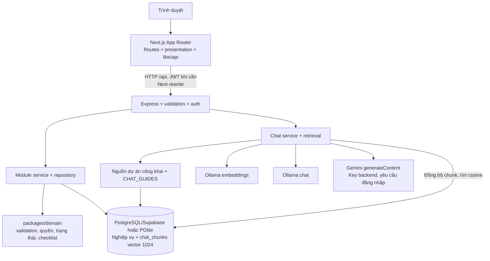
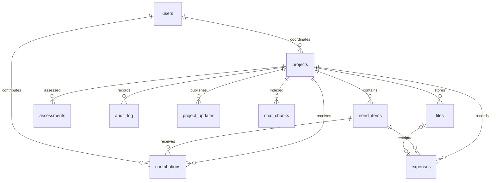

# Kiến trúc hiện tại và hướng hoàn thiện — GOM NẮNG

Kiến trúc phục vụ bản nộp cuối kỳ, đối chiếu source ngày 25/10/2026. Mô tả code không phải xác nhận deploy. Xem [requirements](requirements.md), [traceability](traceability.md) và [ADR](adr/README.md).

## 1. Sơ đồ hệ thống hiện tại



Một tiến trình backend chọn một môi trường DB: có `DATABASE_URL` thì PostgreSQL, không có thì PGlite. Supabase ở đây cung cấp PostgreSQL; không suy ra đã dùng Supabase Auth/Storage. **Chọn Gemini vẫn dùng Ollama cho embeddings.**

Frontend có mock adapter lưu dữ liệu demo trong trình duyệt. Mock không đi qua API/database, không gọi được chatbot và không là bằng chứng tích hợp.

## 2. Trách nhiệm các lớp

| Lớp | Source | Trách nhiệm |
| :-- | :-- | :-- |
| Route web | [fe/src/app](../fe/src/app) | Route mỏng, layout, trang hướng dẫn; nhiều màn nghiệp vụ tải dữ liệu phía client |
| Presentation | [fe/src/presentation](../fe/src/presentation) | Form, dashboard, bảng, dialog, hooks và trạng thái UI |
| HTTP/mock/session | [fe/src/libs](../fe/src/libs) | Chọn adapter, gửi request/JWT, xử lý lỗi và phiên |
| Composition root | [app.ts](../be/src/app.ts), [server.ts](../be/src/server.ts) | Khởi tạo dependencies, DB, model và mount routes |
| Feature modules | [be/src/modules](../be/src/modules) | Nghiệp vụ: route → middleware → controller → service → repository |
| Shared domain | [packages/domain/src](../packages/domain/src) | Types, validation, quyền, trạng thái, views và checklist quy tắc |
| Infrastructure | [be/src/infrastructure](../be/src/infrastructure) | DB driver/schema/migration, audit và logging |

Ngoại lệ hiện hữu: chat route gọi service trực tiếp; `chat.retrieval.ts` truy vấn chỉ mục bằng Drizzle. Không mô tả controller/repository chat chưa tồn tại.

Next build có prerender trang tĩnh và render route động; không đồng nghĩa toàn bộ dữ liệu dự án được fetch và render ở server. Khi bảo vệ SSR/SSG, chỉ đúng trang, ví dụ `/help`, và output build thật.

## 3. Luồng tạo và xác minh dự án

1. `NewProjectPage`/`ProjectForm` → `use-project-form` → shared validation → adapter HTTP.
2. Next rewrite `/api/projects` sang backend; middleware xác thực JWT và kiểm body bằng Zod.
3. Service lấy actor từ phiên, kiểm business rules, transaction ghi `projects`, `need_items`, `audit_log`.
4. `POST /api/projects/:id/submit`: khóa dự án, kiểm lại quyền/dữ liệu, gọi `assessProject`, lưu assessment, chuyển `pending_verification` và ghi audit.
5. Người xác minh duyệt/trả lại qua `/review`; domain rule chặn xung đột lợi ích và bắt buộc lý do khi trả lại.

Nguồn: [projects.service.ts](../be/src/modules/projects/projects.service.ts), [verification.service.ts](../be/src/modules/verification/verification.service.ts), [assess.ts](../packages/domain/src/assess.ts). **Checklist hiện dùng quy tắc + Jaccard, không gọi LLM.** LLM gatekeeper chỉ là một phương án AI thứ hai ở [AI design](ai-design.md#7-năng-lực-ai-thứ-hai-chưa-quyết-định), chưa chọn.

## 4. Đường đi của một request RAG

```mermaid
sequenceDiagram
    participant U as Người dùng
    participant FE as ChatWidget
    participant API as Chat route/service
    participant DB as PostgreSQL hoặc PGlite
    participant E as Ollama embeddings
    participant M as Model chat được chọn
    U->>FE: Gửi câu hỏi
    FE->>API: POST /api/chat, history và model
    API->>API: Validate; kiểm JWT nếu Gemini
    API->>DB: Đọc các trường dự án công khai
    API->>API: Tạo document và chia chunk cùng hướng dẫn
    API->>DB: Đọc hash và model của chunk đã có
    opt Chunk mới, đổi nội dung hoặc embedding model
        API->>E: Embed các chunk thay đổi
        E-->>API: Vectors 1024 chiều
        API->>DB: Upsert chunks
    end
    API->>DB: Xóa chunk không còn trong bộ nguồn mong muốn
    API->>E: Embed câu hỏi
    E-->>API: Query vector
    API->>DB: Cosine search, top-k và ngưỡng
    DB-->>API: Các đoạn nguồn
    alt Không có nguồn
        API-->>FE: Chưa đủ thông tin
    else Có nguồn
        API->>M: System prompt, history, nguồn và câu hỏi
        M-->>API: Toàn bộ câu trả lời dạng text
        API->>API: Kiểm số trích dẫn; lọc sources được dẫn
        API-->>FE: JSON reply, sources, generatedByModel
    end
    FE-->>U: Câu trả lời và link nguồn hoặc thông báo lỗi
```

Đây là nhánh semantic thông thường. Lời chào và câu hỏi liệt kê danh mục được trả bằng quy tắc, không gọi embeddings/LLM. Danh mục giới hạn 10 nguồn hiển thị, báo số dự án còn lại.

Nguồn: [chat.service.ts](../be/src/modules/chat/chat.service.ts), [chat.retrieval.ts](../be/src/modules/chat/chat.retrieval.ts). Hiện trả JSON một lần, chưa streaming. Kiểm số trích dẫn hợp lệ chưa kiểm được tính đúng đắn của mọi khẳng định.

## 5. Dữ liệu và tính nhất quán



Quan hệ rút gọn dựa trên [schema.ts](../be/src/infrastructure/database/schema.ts). `chat_chunks.project_id` có thể null với hướng dẫn tĩnh. `projects.deleted_at` đánh dấu bản nháp đã xoá mềm; `findProject` coi dòng đó như không tồn tại ([ADR-005](adr/005-project-soft-delete.md)). Chứng từ chi tải lên nằm ở bảng `files` (nội dung `bytea`, tối đa 3 MB), khoản chi tham chiếu qua `receipt_file_id` ([ADR-006](adr/006-receipt-storage.md)).

Số lượng và số dư được tính từ đóng góp/khoản chi. Domain rules và constraints tách người ghi/người duyệt. Repository có khóa trong các luồng ghi cạnh tranh. Audit có cơ chế chống sửa/xóa trong migrations; phải kiểm tại đúng môi trường DB khi nộp, không suy ra migration đã chạy trên mọi deploy.

## 6. Xác thực, quyền và dữ liệu gửi model

- Hiện tại: Google cho user thường, bcrypt cho tài khoản mật khẩu; JWT HS256 có sid/purpose, phiên DB và thu hồi khi logout. Admin/verifier chỉ password; dev-login chỉ user khi môi trường cho phép và luôn tắt ở production. [Auth service](../be/src/modules/auth/auth.service.ts) đọc user và phiên hiện tại từ DB khi xác thực.
- Quyền theo dự án và `role=user/admin/verifier` nằm ở [rules.ts](../packages/domain/src/rules.ts). `identityVerified` giữ riêng điều kiện danh tính/tài chính. Auth có Google cho user, phiên server và admin cấp verifier; chi tiết [US-1 local](us1-local.md).
- Nguồn RAG chọn tên, mục tiêu, trạng thái, nhóm thụ hưởng, địa điểm, thời gian và nhu cầu của dự án công khai; không lấy email/passwordHash/phone của user làm context.
- Văn bản tự do/history chưa được chứng minh đã lọc PII. Chọn Gemini gửi những nội dung trong request/context tới Google; chọn Ollama gửi tới endpoint cấu hình, chỉ là local khi endpoint thật sự chạy local.
- API keys ở backend. HTTP log có duration/status/requestId, chưa có tokens/cost/prompt version đầy đủ.

Chính sách đích và test còn thiếu ở [ai-design](ai-design.md). Không khẳng định đã có hàm redact hoặc hạ địa chỉ tới phường nếu source chưa làm.

## 7. Triển khai và phụ thuộc

Dev: `npm.cmd run dev:be`, `npm.cmd run dev:fe` từ root. Mặc định FE 3000, BE 4000, Ollama URL 11434. Backend có thể tự migrate/seed khi khởi động; không khởi động vào DB thật chỉ để kiểm tài liệu.

Có [Compose](../docker-compose.yml), Dockerfile FE/BE và [Render config](../render.yaml). Compose chưa truyền endpoint/key AI hoặc có service Ollama; DB dùng `postgres:17-alpine` trong khi [migration 0007](../be/drizzle/0007_enable_vector.sql) yêu cầu `vector`. Phải kiểm/bổ sung pgvector và kết nối embeddings từ container trước khi xem đây là demo cuối kỳ đầy đủ. Gemini không loại phụ thuộc embeddings Ollama.

Quy trình local/container/hosting, Supabase/PGlite và backup được gộp ở [deployment.md](deployment.md). Docker/hosting cần kiểm chứng trên môi trường dùng để nộp.

## 8. Quyết định kiến trúc

- [ADR-001: PostgreSQL và pgvector](adr/001-postgresql-pgvector.md).
- [ADR-002: Retrieval có nguồn và cấu hình RAG](adr/002-cited-rag.md).
- [ADR-003: Shared domain và backend kiểm quyền](adr/003-shared-domain.md).
- [ADR-004: Structured output cho người gác cổng hồ sơ](adr/004-structured-assessment.md).
- [ADR-005: Xoá dự án chỉ bản nháp, xoá mềm](adr/005-project-soft-delete.md).
- [ADR-006: Chứng từ chi lưu trong PostgreSQL](adr/006-receipt-storage.md).

ADR ghi lựa chọn, phương án thay thế, trade-off và bằng chứng source; không gán cho nhóm thử nghiệm chưa thực hiện. Các phần AI hỗ trợ và việc kiểm tra/chỉnh sửa được ghi theo module ở [AI_USAGE](../AI_USAGE.md).

## 9. Phần cần bổ sung theo đề

OAuth2/admin đã có source và kiểm tra local theo [US-1](us1-local.md), còn Google thật/human review. Năng lực AI thứ hai (structured output, có prompt file và eval 20 ca), xoá bản nháp, phân trang danh sách và tải chứng từ đã có, chờ human review. Real-time, telemetry/dashboard AI chưa hoàn thành; các quyết định còn lại ở requirements.

Lộ trình ở [backlog](backlog.md); bằng chứng ở [traceability](traceability.md). Thiết kế đề xuất không phải xác nhận đã triển khai.
