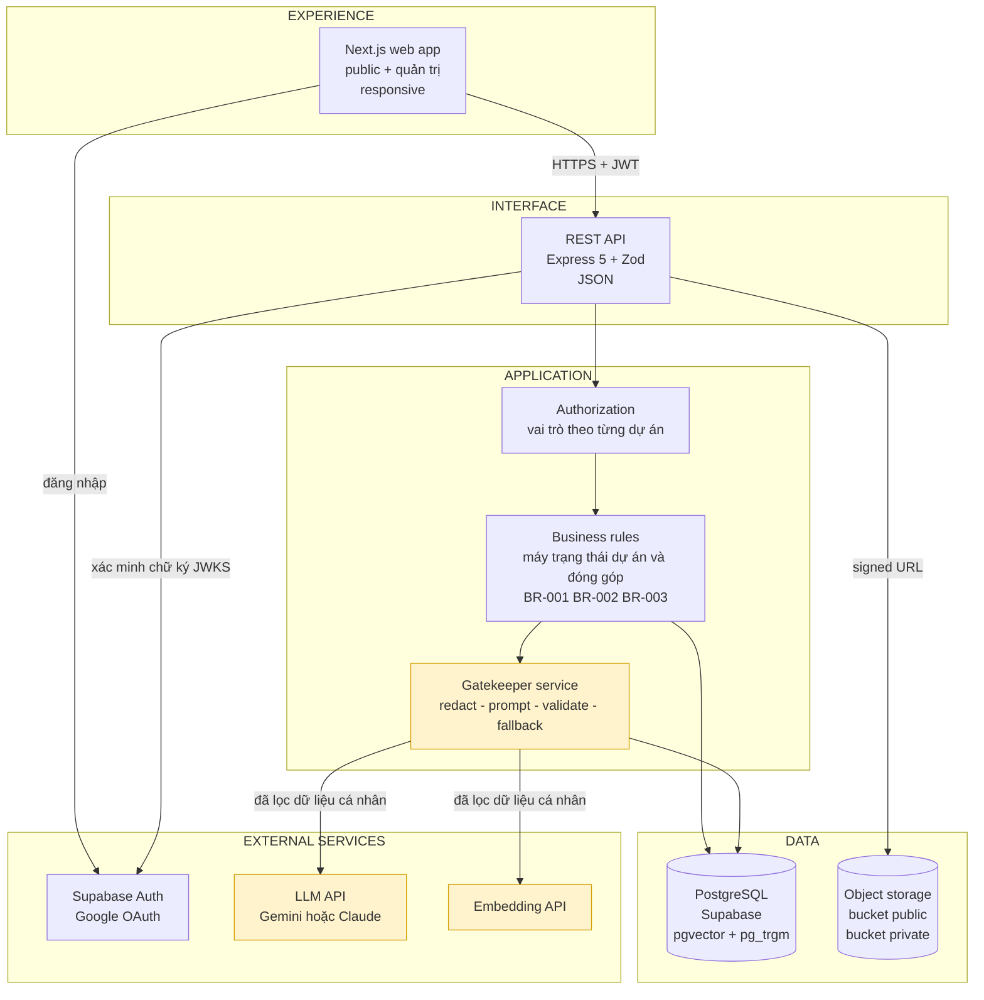
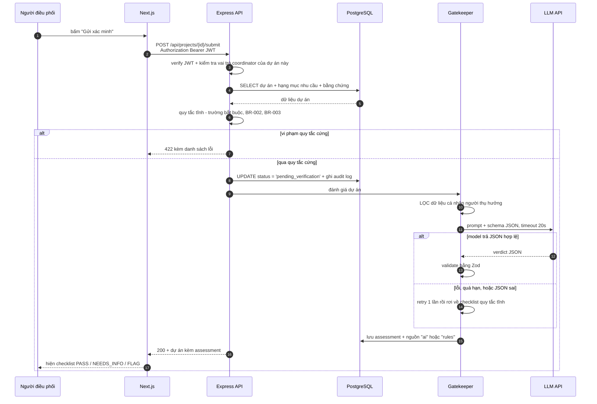
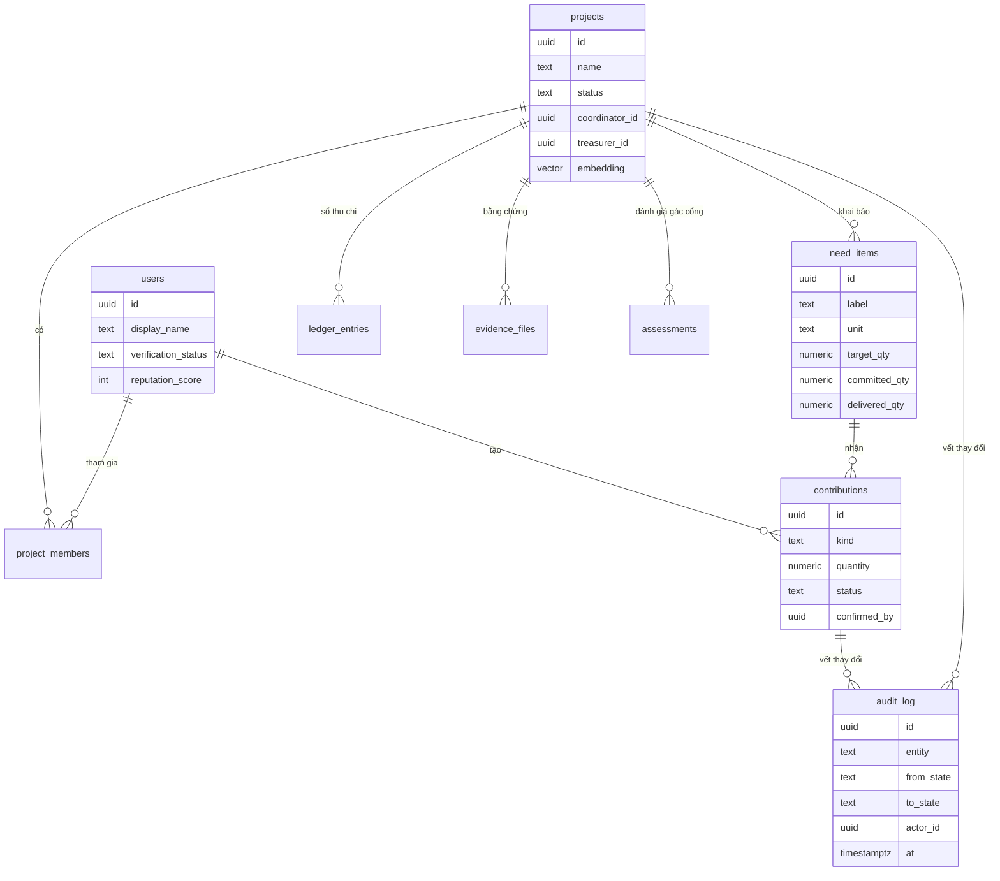
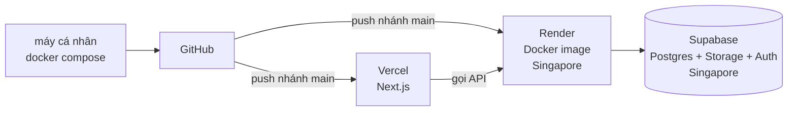
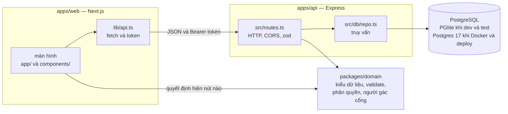

# Architecture — GOM NẮNG

Phiên bản: tuần 2 (đề xuất). Cập nhật lại mỗi khi hiện thực khác thiết kế — mục 10 Course Guide yêu cầu sơ đồ phải khớp với code thật.

---

## 1. Sơ đồ hệ thống

Khối tô vàng là **ranh giới AI**. Mọi thứ ngoài khối đó phải chạy được khi khối đó chết.

## 2. Đường đi của một thao tác — "Gửi dự án đi xác minh"

Đây là bước 2 trong vertical slice, và là đường đi phức tạp nhất của hệ thống.

**Điểm cần nhớ khi bảo vệ:** model **không** ghi trạng thái dự án. Nó chỉ ghi một bản ghi `assessment`. Việc đổi trạng thái sang `published` chỉ xảy ra khi một người xác minh bấm duyệt. Đây là cách chặn prompt injection ở mức kiến trúc chứ không phải ở mức prompt.

## 3. Dữ liệu — mô hình rút gọn

`audit_log` là bảng **chỉ ghi thêm** — không có API nào sửa hay xoá nó. Đây là cách hiện thực NFR "Minh bạch" của đề bài.

## 4. Dữ liệu KHÔNG được gửi ra mô hình bên ngoài

Danh sách này là hợp đồng. Hàm lọc phải có test riêng.

| Trường | Xử lý trước khi gửi |
| :-- | :-- |
| Họ tên đầy đủ người thụ hưởng | Bỏ hoàn toàn |
| Số điện thoại, email, số tài khoản | Bỏ hoàn toàn |
| Địa chỉ nhà người thụ hưởng | Hạ độ chi tiết còn phường/quận |
| Ảnh người thụ hưởng, ảnh giấy tờ | Không gửi, kể cả khi dùng model đa phương thức |
| Ảnh CCCD/thẻ sinh viên của thành viên | Không gửi |
| Nội dung tin nhắn riêng giữa thành viên | Không gửi |

Được gửi: tên dự án, mục tiêu, mô tả hoạt động, danh sách hạng mục nhu cầu, thời gian, địa điểm ở mức phường, loại nhóm thụ hưởng.

## 5. Quyết định triển khai

**Chọn App Platform, đóng gói bằng Docker.**

| Tiêu chí (slide 31) | Lập luận |
| :-- | :-- |
| Problem fit | 1 API + 1 DB + 2 người + 8 tuần. Ràng buộc lớn nhất là **thời gian**, không phải lưu lượng |
| Evidence | Sẽ đo và trình 3 số: thời gian từ `git push` tới khi sống, p95 latency đo từ TP.HCM, chi phí thật một tháng |
| Trade-offs | Mất quyền kiểm soát hạ tầng và khả năng tinh chỉnh sâu. Được 0 giờ vận hành, TLS/scale/log có sẵn |
| Maturity | Mô hình PaaS đã chín từ 2007; không phải công nghệ đang thử nghiệm |
| Risk | Lock-in — hoá giải bằng Dockerfile: chuyển sang Cloud Run hay Kubernetes là đổi cấu hình, không viết lại |
| Alternatives | VM: tốn một tuần cho nginx/certbot/systemd/backup mà không được chấm điểm. Kubernetes: giải bài toán nhiều service nhiều team mà nhóm không có; control plane tốn tiền. Serverless functions: timeout ngắn xung khắc với request LLM 10–30 giây, và mỗi instance mở một connection Postgres nên phải thêm pooler |

**Bẫy đã biết:** gói miễn phí của Render cho service ngủ sau một khoảng không có traffic, đánh thức mất vài chục giây. Trước buổi demo phải xử lý bằng một trong hai cách: cron ping định kỳ, hoặc nâng gói trả phí đúng tuần đó. *Cần đo lại con số thật khi đăng ký, không lấy theo trí nhớ.*

## 6. Quyết định kỹ thuật đã chốt

| # | Quyết định | Lý do ngắn | Đảo ngược được? |
| :-- | :-- | :-- | :-- |
| D-01 | Hệ thống **không giữ tiền**, chỉ ghi sổ và đối chiếu biên lai | Cắt rủi ro pháp lý và PCI mà vẫn giữ giá trị minh bạch | Khó — ảnh hưởng toàn bộ mô hình |
| D-02 | Web trước, không làm app native | 2 người, 8 tuần | Dễ |
| D-03 | Postgres + pgvector, không thêm vector DB riêng | Một hệ thống ít hơn phải vận hành | Dễ |
| D-04 | LLM chỉ **đề xuất**, người xác minh **quyết định** | Chặn injection ở mức kiến trúc; giữ trách nhiệm ở con người | Không nên đảo |
| D-05 | Mọi lời gọi model đi qua một interface `ModelService` | Đổi provider không đụng vào business logic | — |
| D-06 | `audit_log` chỉ ghi thêm, không sửa không xoá | Hiện thực NFR minh bạch | Không nên đảo |
| D-07 | Express + Zod thay vì Fastify | Giữ số thứ lạ ở mức tối thiểu trong tuần bận nhất | Dễ |
| D-08 | Quy tắc nghiệp vụ tách thành `packages/domain`, backend và frontend import chung | Một quy tắc chỉ có một bản code — form trên trình duyệt và API không thể lệch nhau | Dễ |
| D-09 | Dev và test dùng **PGlite** (PostgreSQL chạy nhúng trong Node) | Người mới clone về chạy ngay, không cài gì thêm. *Lúc chốt có ghi thêm lý do "Docker không bật được engine" — lý do đó sai: engine chỉ chưa được mở, và đã chạy ở Homework 4B.* | Dễ — cùng là PostgreSQL |
| D-10 | Tuần 4 phát token bằng `dev-login` (JWT HS256), chưa nối Supabase Auth | Đủ để kiểm quyền theo vai trò ngay bây giờ; endpoint bị tắt cứng khi `NODE_ENV=production` | Dễ |
| D-11 | Sổ ghi vết chặn UPDATE / DELETE / TRUNCATE bằng trigger trong PostgreSQL; BR-003 có thêm CHECK constraint | Chặn ngay ở database, không phụ thuộc việc code backend có nhớ kiểm hay không | Không nên đảo |
| D-12 | So trùng tên dự án bằng Jaccard viết trong JS, chưa dùng `pg_trgm` | Không cần extension, chạy giống hệt ở mock frontend, đủ nhanh tới vài nghìn dự án | Dễ — có ghi chú `ponytail:` trong code |
| D-13 | Số lượng cam kết / bàn giao / xác nhận luôn **tính** từ bảng đóng góp, không lưu thành cột | Con số trên màn hình không bao giờ lệch với sổ đóng góp | Dễ |
| D-14 | Frontend gọi thẳng backend; backend bật CORS cho đúng origin của web, không dùng thư viện `cors` | Web và API deploy ở hai nơi. CORS chỉ cần vài header; origin lạ không nhận header nào | Dễ — đổi sang proxy của Next nếu muốn cùng origin |
| D-15 | Bỏ mock API của 3B, thay bằng client `fetch` thật; test frontend chạy trên backend thật trong cùng tiến trình | Chỉ còn một đường code; frontend và backend lệch contract là test hỏng ngay | Dễ — mock vẫn nằm trong lịch sử git |
| D-16 | Backend nhận hai driver: PGlite khi không có `DATABASE_URL`, `node-postgres` khi có | Dev và test không cần cài gì; Docker Compose và bản deploy chạy PostgreSQL thật | Dễ |
| D-17 | Docker Compose chạy Postgres 17 thật, không dùng PGlite trong container | Chạy thử đúng đường code sẽ chạy trên Supabase trước khi deploy | Dễ |
| D-18 | Bật Row Level Security, không tạo policy, trên mọi bảng (migration `0002`) | Supabase tự mở schema `public` qua Data API cho ai có anon key. RLS không policy chặn đường đó; backend là chủ bảng nên không bị ảnh hưởng | Không nên đảo |
| D-19 | Bản deploy cho đăng nhập bằng tài khoản mẫu, bật bằng biến riêng `ALLOW_DEMO_LOGIN_IN_PRODUCTION=true` | Demo được đủ luồng trên link công khai; toàn dữ liệu giả. Không có biến đó thì production vẫn tắt, server ghi cảnh báo khi bật | Dễ — đặt biến thành `false` |
| D-20 | Kết nối Supabase có mã hoá TLS nhưng chưa kiểm chứng chứng chỉ nếu thiếu `DATABASE_CA_CERT` | Chạy được ngay, không phải tải file chứng chỉ; server ghi cảnh báo mỗi lần khởi động | Dễ — dán chứng chỉ CA của Supabase vào biến |

## 7. Cấu trúc code — tuần 4

Mỗi request vào backend đi đúng ba bước, và mỗi bước nằm ở một file khác nhau:

| Bước | File | Trả lỗi |
| :-- | :-- | :-- |
| 1. Đọc và kiểm **định dạng** request | `apps/api/src/routes.ts` (zod) | 400 |
| 2. Hỏi domain xem thao tác có **được phép** không | `packages/domain/src/rules.ts`, `validate-project.ts` | 403 / 409 / 422 |
| 3. Ghi dữ liệu trong một transaction, kèm một dòng sổ ghi vết | `apps/api/src/db/repo.ts` | — |

Frontend cũng gọi bước 2 — nhưng chỉ để quyết định **hiện nút nào**, không phải để chặn. Chặn thật luôn là backend: sửa code trên trình duyệt để hiện nút "Xác nhận" thì request vẫn nhận 403. Chính sách mã lỗi đầy đủ: [`api-contract.md` §2](api-contract.md#2-chính-sách-mã-trạng-thái).
