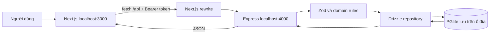

# GOM NẮNG — Kế hoạch học và hoàn thiện bài tập đến 4A, sau đó tích hợp local

Ngày đối chiếu: 14/09/2026. Đây là kế hoạch thực hiện, không phải biên bản xác nhận phần mềm đã chạy thành công.

## 1. Nguồn yêu cầu và điểm dừng

- `New Technologies in Software Engineering - 8 Week Course and Homework Plan 2026.docx`: quy định thứ tự bài tập, sản phẩm và bằng chứng cần nộp.
- `PROBLEM SPECIFICATION.docx`: mô tả nghiệp vụ nền tảng thiện nguyện; phạm vi đầy đủ rộng hơn một bài tập tuần 4.
- Mã nguồn và tài liệu trong repo: dùng xác định phần có sẵn và phần cần bổ sung. Các dấu hoàn thành trong tài liệu cũ cần được kiểm chứng trên commit nộp.

**4A = backend cho một luồng hoàn chỉnh + database bền vững + kiểm thử API. Kết nối frontend vào backend thật thuộc 4B.** Vì mục tiêu của bạn là chạy được FE–BE–DB, kế hoạch gồm 1A → 4A, rồi phần tích hợp local của 4B. Docker/deploy và hồ sơ vận hành đầy đủ là phần tiếp theo nếu cần nộp trọn 4B.

Tích hợp AI vào ứng dụng bắt đầu ở tuần 6; riêng 2B đã yêu cầu một lần gọi LLM thử độc lập. Không bỏ bài smoke test 2B chỉ vì chưa học phần AI chính thức.

## 2. Dự án bạn muốn làm

**GOM NẮNG là nền tảng web giúp cá nhân và nhóm địa phương cùng tổ chức hoạt động thiện nguyện: công khai nhu cầu, kết nối người đóng góp, xác minh dự án và theo dõi nguồn lực từ cam kết đến bàn giao, xác nhận.**

Ví dụ: một nhóm muốn tổ chức “100 phần cơm cho mái ấm Hoa Mai”. Người điều phối khai báo mục tiêu, nhóm thụ hưởng, thời gian, địa điểm và nhu cầu 100 phần cơm. Người xác minh kiểm tra rồi duyệt công khai. Người đóng góp thấy còn thiếu bao nhiêu và nhận lo 30 phần. Khi bàn giao, người có quyền xác nhận ghi nhận việc nhận thực tế; hệ thống hiển thị tiến độ và lịch sử ai làm gì, lúc nào.

Giá trị cốt lõi là giúp người tham gia biết **cần gì, ai chịu trách nhiệm, đã nhận được gì và có lịch sử đối chiếu**.

| Vai trò | Trong luồng tối thiểu |
| --- | --- |
| Người khởi xướng/điều phối | Tạo và sửa bản nháp, khai báo nhu cầu, gửi xác minh, xác nhận bàn giao theo quyền |
| Người đóng góp | Xem dự án công khai, cam kết số lượng, báo đã bàn giao |
| Người xác minh | Xem hàng chờ, duyệt hoặc trả về kèm lý do; không tự duyệt dự án mình điều phối |
| Người phụ trách tài chính | Được chỉ định khi có nhu cầu tiền, phải đã xác minh; quyền xác nhận cần chốt theo BR-003 |
| Quản trị viên | Thuộc định hướng đầy đủ; chưa có phân hệ quản trị hoàn chỉnh trong code hiện tại |

Ba user story ưu tiên đã có trong `proposal.md`: US-1 khai báo nhu cầu định lượng; US-2 cam kết một phần cụ thể; US-3 xác minh trước khi công khai.

**Phạm vi tới mốc chạy local:** tạo dự án → gửi xác minh → duyệt → công khai → cam kết → bàn giao → xác nhận → xem tiến độ và lịch sử. Demo chính dùng vật phẩm để dễ hiểu; vẫn kiểm tra quy tắc tiền hiện có bằng các ca riêng.

**Để sau mốc này:** bảng công việc/phân công, sổ thu chi và hóa đơn đầy đủ, upload bằng chứng, tổng kết dự án, hồ sơ uy tín, thông báo, OAuth và AI đánh giá bằng LLM. Đây là phạm vi còn lại của sản phẩm, không được mô tả là đã hoàn thành.

AI dự kiến hỗ trợ nhận diện thông tin thiếu hoặc dấu hiệu cần kiểm tra khi gửi xác minh. Người xác minh quyết định cuối cùng. Hiện `assess.ts` là quy tắc tĩnh và so khớp tên, chưa phải tích hợp LLM.

## 3. Hiện trạng được đối chiếu với code

| Phần | Đã thấy trong repo | Còn phải làm/kiểm chứng |
| --- | --- | --- |
| Môi trường | Node trên máy: v22.21.0; repo có lịch sử Git | Chưa có `node_modules` tại lúc khảo sát; cần cài và chạy lại |
| 1A | Repo và code có sẵn | Checklist công cụ, bằng chứng starter/thay đổi nhìn thấy được, URL và commit nộp |
| 1B | Bối cảnh và người dùng trong proposal | Chưa có `docs/week-01.md`; tài liệu cũ ghi chưa phỏng vấn thật; thiếu hồ sơ 3 vấn đề ứng viên |
| 2A | Có kiến trúc GOM NẮNG | Chưa có bài khảo sát một ứng dụng có sẵn; backlog ghi `week-02a.md` còn thiếu |
| 2B | Proposal, 3 story, kiến trúc, backlog có owner; có script LLM | `docs/evidence` mới có README, chưa có kết quả smoke test; cần bằng chứng proposal được duyệt |
| 3A–3B | Next.js/React, form, các màn danh sách/chi tiết/tạo/sửa/xác minh; mock và test | Chạy lại UI, acceptance test, quay video; hoàn tất human review |
| 4A | Express + Zod + JWT demo; Drizzle/PGlite; migration; health/log; 16 khai báo API test | Chạy test, restart, đọc DB và log tại máy này; đối chiếu nghiệp vụ và chốt commit |
| Nối FE–BE | Đã có adapter mock/HTTP, Bearer token, sessionStorage và Next.js rewrite; E2E đã chạy qua DB thật | Hoàn thiện hồ sơ 4B: đóng gói, deploy/lý do local, video và tài liệu vận hành |

**Cập nhật 15/09/2026:** đã cài dependency, chạy lại 51 test, typecheck, frontend build, backend health và E2E FE–BE–DB. Xem bằng chứng mới nhất tại [week-03-04-review.md](week-03-04-review.md).

## 4. Các khác biệt cần giải quyết trước khi nhận bài là hoàn chỉnh

| Nội dung | Đặc tả gốc và hiện trạng | Hành động trong kế hoạch |
| --- | --- | --- |
| Trạng thái đóng góp | Gốc: đề xuất → cam kết → bàn giao → xác nhận. Code tạo thẳng `committed` | Nếu giảng viên yêu cầu đủ chuỗi, bổ sung bước `proposed` đồng bộ domain, API, mock, UI và test; nếu được phép thu hẹp, ghi rõ vào phạm vi MVP |
| Vòng đời dự án | Gốc có “đang tìm thành viên”, “đang thực hiện”, “đã hoàn thành”. Luồng API hiện tập trung draft → pending_verification → published | Mốc tuần 4 dừng ở công khai và đóng góp; không khẳng định hỗ trợ trọn vòng đời |
| BR-003 | Gốc cấm người giữ tiền là người duy nhất xác nhận toàn bộ thu chi. Code yêu cầu người tài chính khác điều phối, chỉ điều phối xác nhận tiền, cấm tự xác nhận đóng góp | Xác nhận đây là cách thiết kế của nhóm. Giải quyết trường hợp điều phối tự góp tiền vào dự án mình vì hiện không có người xác nhận hợp lệ |
| Tên bảng | Đặc tả dùng `charity_projects`, code dùng `projects` | Ghi bảng ánh xạ; không cần đổi tên chỉ để giống chữ nếu không có yêu cầu bắt buộc |
| Kiến trúc | Sơ đồ đầu `architecture.md` là thiết kế tương lai có Supabase/OAuth/storage/AI; mục 7 gần code hiện tại hơn | Đặt sơ đồ hiện tại lên trước, gắn nhãn rõ phần dự kiến |
| Kịch bản proposal | Có bước bỏ trống địa điểm rồi gửi xác minh, nhưng form/API hiện bắt buộc địa điểm | Demo lỗi form trước; nhập địa điểm hợp lệ rồi mới tạo/gửi. Dùng nội dung thiếu chi tiết nếu cần minh họa checklist tĩnh |
| Chứng cứ chạy | Một số lệnh cũ dùng Git Bash hoặc đường dẫn máy khác | Bổ sung hướng dẫn PowerShell và chạy tại thư mục repo hiện tại |

Những lựa chọn thu hẹp cần được trình bày khi xin duyệt phạm vi. Chưa có bằng chứng trong lượt khảo sát này rằng giảng viên đã chấp thuận chúng.

## 5. Kế hoạch theo đúng thứ tự bài tập

Mỗi chặng: đọc yêu cầu → giải thích kiến thức → kiểm tra phần có sẵn → làm phần thiếu → chạy kiểm chứng → ghi bằng chứng. Không cần viết lại toàn bộ repo để học từ đầu.

### Homework 1A — Môi trường và Git

1. Kiểm tra Git, editor, Node, npm; kiểm tra Docker nếu máy hỗ trợ, ghi hạn chế thực tế nếu có.
2. Đối chiếu starter do giảng viên cung cấp với repo hiện có; bổ sung bằng chứng starter nếu còn thiếu.
3. Cài dependency từ lockfile; chạy frontend mock và chỉ ra một thay đổi nhìn thấy được, tạo commit có ý nghĩa.
4. Xác nhận dùng được AI coding assistant được môn học cho phép.

**Hiểu được:** repository, clone, commit, dependency, terminal chạy server.

**Sản phẩm:** phần 1A trong `docs/week-01.md`, tool checklist, URL repo, commit hash, hình/video chạy, một blocker. Kiểm tra URL repo thực tế; không mặc định dòng “chưa push” trong tài liệu cũ vẫn đúng.

### Homework 1B — Khám phá vấn đề

1. Liệt kê ba vấn đề ứng viên, chẳng hạn kết nối nguồn lực, phân công tình nguyện viên, đối chiếu đóng góp; giải thích vì sao chọn vấn đề làm GOM NẮNG.
2. Tham vấn/phỏng vấn/quan sát ít nhất một người dùng hoặc bên liên quan thật, ví dụ người tổ chức CLB thiện nguyện. Ghi ngày, vai trò, vấn đề họ gặp và kết luận ảnh hưởng đến phạm vi.
3. Viết problem brief một trang: bối cảnh, người dùng, khó khăn, giá trị và hành vi hữu ích khi không có AI.
4. Nêu một lợi ích AI dự kiến và một lý do AI có thể thừa hoặc sai. Chuẩn bị giải thích 60 giây.

**Sản phẩm:** brief và ghi chép thật trong repo, liên kết từ `week-01.md`. Nội dung phỏng vấn phải do hoạt động thực tế cung cấp; không điền nhận xét giả để hoàn thiện checklist.

### Homework 2A — Khảo sát kiến trúc một ứng dụng có sẵn

1. Chọn ứng dụng đang tồn tại mà nhóm có thể quan sát; ghi tên, URL và thao tác khảo sát.
2. Vẽ frontend, backend, business logic, database, deployment và external services có khả năng tồn tại. Gắn nhãn “suy luận” cho chi tiết không có tài liệu xác nhận.
3. Theo dấu một thao tác: bấm nút → request/JSON → server kiểm tra → DB đọc/ghi → response → giao diện cập nhật.
4. Đánh dấu nơi có thể thêm AI và dữ liệu không được gửi ra model; nhận một góp ý từ nhóm khác rồi sửa sơ đồ.

**Hiểu được:** HTTP request/response, API, trách nhiệm từng tầng, khác nhau giữa quan sát và suy đoán kiến trúc.

**Sản phẩm:** `docs/week-02a.md`, một sơ đồ và phần giải thích luồng khoảng một trang. Kiến trúc riêng GOM NẮNG không thay thế bài khảo sát này.

### Homework 2B — Đề xuất GOM NẮNG và LLM smoke test

1. Rà soát `proposal.md`: problem, người dùng, US-1/2/3 và acceptance criteria; xử lý các khác biệt ở mục 4.
2. Chốt một demo dưới hai phút và ranh giới MVP. Chọn stack bám code: Next.js/React → Express/Zod → Drizzle/PGlite cho local.
3. Cập nhật kiến trúc và backlog tám tuần có owner; tách công nghệ đã dùng với công nghệ dự kiến triển khai.
4. Chạy script/notebook giảng viên; nếu chưa có, dùng script hiện có khi được môn học chấp nhận. Lưu ít nhất một prompt, response thật, model và latency.
5. Ghi lợi ích AI, nguy cơ, fallback; lưu phản hồi duyệt proposal.

**Sản phẩm:** proposal, architecture, backlog, `docs/week-02.md`, output smoke test trong `docs/evidence/`. Script hiện hỗ trợ nhiều provider; chọn dịch vụ được lớp cho phép và có quyền truy cập. API key không phải điều kiện của mọi phương án, ví dụ lớp có thể cung cấp model service nội bộ.

### Homework 3A — Bộ khung giao diện

1. Đọc `fe/app/page.tsx`, trang chi tiết, `components/ProjectForm.tsx`; chỉ ra component, props, state và event submit.
2. Chạy danh sách → chi tiết → form tạo dự án với mock.
3. Thử form thiếu trường, số lượng sai, ngày sai và trường hợp tài chính BR-002/003.
4. Kiểm tra loading/empty/success/error, màn hình nhỏ, label, bàn phím, thông báo lỗi và dữ liệu form được giữ khi gửi thất bại.
5. Review code do AI tạo, ghi người review và sửa thực tế.

**Sản phẩm:** commit frontend chạy được, video khoảng một phút, bằng chứng validation, cập nhật `docs/week-03.md` và AI log.

### Homework 3B — Hoàn thiện luồng bằng mock

1. Chạy đủ luồng bằng ba tài khoản mẫu: điều phối → xác minh → đóng góp; sau đó quay về người có quyền xác nhận.
2. Đọc `lib/api.ts`, `lib/session.ts`, `lib/use-load.ts`: phân biệt dữ liệu mock/localStorage, người dùng mẫu và request HTTP thật.
3. Đối chiếu từng hàm mock với endpoint và request/response trong `docs/api-contract.md`.
4. Chạy ít nhất ba test/acceptance case: luồng hợp lệ; cam kết vượt nhu cầu; chuyển trạng thái hoặc thao tác sai quyền.
5. Ghi hướng dẫn chạy và vị trí cấu hình; quay video và chốt commit.

**Điều kiện xong:** toàn bộ luồng UI hoạt động trên mock, không phụ thuộc backend, có đủ trạng thái lỗi và API contract để làm 4A.

### Homework 4A — Backend và dữ liệu bền vững

Chia thành các bước nhỏ, mỗi bước tập trung một request hoặc một quy tắc:

| Bước | Việc học và kiểm tra | File chính | Bằng chứng hoàn thành |
| --- | --- | --- | --- |
| 4A.1 | Đọc cấu hình, khởi động API và kiểm tra DB | `src/config.ts`, `server.ts`, `app.ts` | `/health` trả 200 và `db: ok`; log khởi động |
| 4A.2 | Hiểu schema, khóa ngoại, migration và seed | `src/db/schema.ts`, `client.ts`, `seed.ts`, `drizzle/` | Đọc được user/dự án; biết dữ liệu nằm ở đâu |
| 4A.3 | Đăng nhập demo, JWT và xác thực request | `src/auth.ts` | Có token mới thao tác được; không có/giả token nhận 401 |
| 4A.4 | Tạo và đọc dự án qua API | `src/routes.ts`, domain validation, `src/db/repo.ts` | POST hợp lệ → 201; GET đọc lại đúng dữ liệu; sai kiểu → 400 |
| 4A.5 | Gửi xác minh và duyệt/trả về | routes + domain rules/assess | Trạng thái đúng; sai vai bị chặn; có assessment quy tắc tĩnh và audit |
| 4A.6 | Cam kết, bàn giao, xác nhận | routes + domain rules + repo | Đúng luồng; quá số lượng → 422; sai trạng thái → 409; sai quyền → 403 |
| 4A.7 | Kiểm chứng lưu bền vững, log, kiểm thử | `test/api.test.ts`, `src/http.ts`, SQL script | Test chạy thật, log và dữ liệu đối chiếu được; restart vẫn còn |

Đường đọc code của một thao tác: `app.ts` → middleware trong `auth.ts` → `routes.ts` (HTTP và Zod) → `packages/domain` (nghiệp vụ) → `db/repo.ts` (truy vấn/transaction) → JSON → client. Repo hiện không có controller/service riêng; học theo cấu trúc thật này trước.

Sáu bảng đang có: `users`, `projects`, `need_items`, `contributions`, `assessments`, `audit_log`. Một dự án có nhiều nhu cầu; một nhu cầu có nhiều đóng góp; người dùng tạo đóng góp; trạng thái thay đổi được ghi audit. Tiến độ được tính từ đóng góp, không lấy localStorage làm dữ liệu backend.

**Bộ endpoint hiện có để kiểm tra:**

| Thao tác | Endpoint |
| --- | --- |
| Kiểm tra dịch vụ và DB | `GET /health` |
| Lấy token demo | `POST /api/auth/dev-login` |
| Lấy thành viên | `GET /api/users` |
| Danh sách và chi tiết dự án | `GET /api/projects`, `GET /api/projects/:id` |
| Tạo và sửa dự án | `POST /api/projects`, `PUT /api/projects/:id` |
| Gửi xác minh | `POST /api/projects/:id/submit` |
| Hàng chờ và duyệt/trả về | `GET /api/verification-queue`, `POST /api/projects/:id/review` |
| Cam kết đóng góp | `POST /api/projects/:id/contributions` |
| Bàn giao/xác nhận | `POST /api/contributions/:id/transition` |

**Bằng chứng nộp 4A:** commit API, output test (ít nhất một request hợp lệ và một không hợp lệ), request/response mẫu, log ứng dụng, dữ liệu DB trước/sau, chứng minh restart còn dữ liệu; `.env.example` có tên biến, secret thật nằm ngoài Git. Hoàn tất checklist và ghi một blocker trong `docs/week-04.md`.

**Năm bước demo đúng đề:** bật API và gọi health → request hợp lệ/sai → chỉ dữ liệu và log → dừng/bật lại rồi đọc bản ghi cũ → giải thích status code và business rule.

## 6. Bước tiếp nối: FE–BE–DB cùng chạy local (phần tích hợp của 4B)

### Kiến trúc đích cho mốc này



Giữ PGlite đang có cho mốc học và demo local: code mở DB bằng đường dẫn `.data/pglite`, không phải chỉ lưu RAM. PGlite hỗ trợ lưu filesystem trong Node ([tài liệu PGlite](https://pglite.dev/docs/)). Không phải cài một PostgreSQL service riêng mới chứng minh được FE–BE–DB. Nếu lớp bắt buộc DB server/container riêng thì thêm bước chuyển driver và kiểm chứng migration, không chỉ thêm `DATABASE_URL` vào cấu hình hiện tại.

Đề xuất dùng Next.js rewrite để chuyển `/api/:path*` sang Express; browser gọi cùng origin với frontend. Cơ chế rewrite có hỗ trợ đích bên ngoài ([tài liệu Next.js](https://nextjs.org/docs/app/api-reference/config/next-config-js/rewrites)). Nếu chọn gọi thẳng cổng 4000, phải cấu hình CORS cho origin frontend và kiểm tra preflight/Authorization. Chốt một cách cho local để hướng dẫn dễ theo dõi.

### Thứ tự tích hợp

1. **Cấu hình đường gọi API:** bổ sung backend origin ở `fe/.env.example` và rewrite trong `next.config.mjs`; thử một GET public trước. Khởi động lại Next sau khi đổi cấu hình.
2. **Đổi tài khoản phải đăng nhập BE:** cập nhật `session.ts` và `UserSwitcher.tsx` để gọi `dev-login`, nhận token cùng user. Token gửi trong `Authorization: Bearer ...`. Không suy ra quyền backend từ ID lưu sẵn ở localStorage. Đây là đăng nhập demo local; endpoint này bị tắt trong production.
3. **Tách adapter mock và HTTP:** giữ mock để trình bày 3B; bổ sung HTTP adapter phía sau cùng các hàm hiện có trong `lib/api.ts`. Chuyển lần lượt list/detail → create/update → submit/review → contribution/transition. Giữ `ApiError`, mã lỗi và hình dạng dữ liệu để UI sử dụng được.
4. **Xử lý session và lỗi thật:** hết hạn token → 401 và đăng nhập lại; 403/409/422 hiển thị đúng thông báo; mất kết nối/timeout có retry và giữ nội dung form. Khi đổi tài khoản phải nạp lại dữ liệu theo quyền người mới.
5. **Cập nhật UI sau khi ghi:** sau POST/PUT thành công đọc lại dữ liệu từ API; đổi mock ID sang ID backend trả về. Nút reset localStorage và chế độ lỗi giả chỉ dùng cho mock. Chế độ thật không tự rơi về mock khi backend tắt.
6. **Chạy trọn luồng và kiểm tra DB:** thao tác trình duyệt tạo bản ghi thật, đối chiếu ID qua GET và SQL, refresh vẫn còn; restart backend rồi mở lại đúng ID.
7. **Chốt hướng dẫn tái lập:** cập nhật README, sơ đồ hiện tại, config, lệnh bật/tắt/test, AI log; ghi bằng chứng tích hợp vào phần 4B riêng. Chạy frontend build, typecheck backend, các bộ test liên quan và acceptance test trình duyệt.

### Kịch bản nghiệm thu đầu-cuối

| Ca | Hành vi cần thấy |
| --- | --- |
| Tạo dự án mới hợp lệ | UI nhận ID backend, DB có dự án draft và nhu cầu |
| Gửi xác minh, đổi sang Tâm để duyệt | Người xác minh thấy đúng dự án; duyệt xong xuất hiện công khai |
| An cam kết 30/100 phần cơm | DB có contribution, UI hiển thị đã cam kết 30, còn thiếu 70 |
| Thử thêm 150 phần | API trả 422; UI hiện lỗi; DB không ghi thêm đóng góp sai |
| Báo bàn giao, Khanh xác nhận | Trạng thái đúng thứ tự; audit ghi người thực hiện; số đã xác nhận là 30 |
| Người góp tự xác nhận | API chặn, UI báo lỗi hoặc không hiển thị thao tác |
| Refresh/mở phiên trình duyệt khác | Dữ liệu từ server còn nguyên; nếu cần, đăng nhập lại đúng vai |
| Dừng rồi bật backend | GET theo ID cũ đọc đúng bản ghi, không phụ thuộc seed mới |
| Tắt backend rồi thao tác trên UI | Báo lỗi mạng/service, không hiển thị thành công giả từ mock; bật lại có thể thử lại |

**Điều kiện đạt đích của bạn:** thao tác từ giao diện → HTTP thật → backend kiểm tra → DB lưu → UI đọc lại; có bằng chứng lỗi và restart. Để nộp đầy đủ 4B, bổ sung đóng gói Docker hoặc setup tương đương tái lập được, deploy khi khả thi hoặc lý do chạy local, video và commit chính xác.

## 7. Lệnh dự kiến dùng khi bắt đầu chạy trên Windows

Các lệnh dưới đây bám scripts đang có nhưng **chưa được thực thi trong lượt lập kế hoạch này**.

Tại PowerShell, từ thư mục gốc:

```powershell
Set-Location 'C:\Users\GameLap\Desktop\zoo_git\GomNang'
npm.cmd ci
```

Tạo file cấu hình chỉ khi chưa có, tránh ghi đè giá trị đang dùng:

```powershell
if (-not (Test-Path 'be/.env')) {
    Copy-Item 'be/.env.example' 'be/.env'
}
```

Điền `JWT_SECRET` ngẫu nhiên dài ít nhất 32 ký tự trong `be/.env`; giữ file này ở máy, không đưa vào bài nộp. Sau đó mở hai terminal ở gốc repo:

```powershell
# Terminal backend
npm.cmd run dev:api
```

```powershell
# Terminal frontend
npm.cmd run dev:web
```

Terminal kiểm tra:

```powershell
Invoke-RestMethod 'http://localhost:4000/health'
npm.cmd test
npm.cmd run typecheck
npm.cmd run build -w gomnang-web
```

`npm run typecheck` ở gốc hiện chỉ kiểm kiểu backend; frontend cần kiểm qua build. Mở `http://localhost:3000`; trước khi thực hiện mục 6, đây vẫn là frontend mock dù cả hai server cùng bật.

Dừng backend bằng Ctrl+C trước khi dùng SQL script mở cùng thư mục PGlite; theo dõi log đóng DB. Ví dụ đọc dữ liệu sau khi đã dừng:

```powershell
npm.cmd run sql -w gomnang-api -- 'select id, name, status from projects order by created_at desc limit 5'
npm.cmd run sql -w gomnang-api -- 'select entity_type, from_state, to_state, at from audit_log order by at desc limit 10'
```

Không reset DB trong ca kiểm tra lưu bền vững. Khởi động API lại sau khi SQL script kết thúc.

## 8. Thứ tự các buổi làm thực tế

Ước lượng 8–10 buổi ngắn, mỗi buổi khoảng 1–2 giờ, tùy lỗi môi trường và tốc độ đọc hiểu. Đây là gợi ý nhịp học, không phải lịch LMS hay cam kết thời gian hoàn thành. Phỏng vấn, phản hồi giảng viên và quyền truy cập model có thể cần thời gian chờ riêng.

| Buổi | Trọng tâm | Kết quả trước khi chuyển tiếp |
| --- | --- | --- |
| 1 | 1A + hiểu tổng quan repo | Chạy FE mock, hiểu workspace và commit, checklist môi trường |
| 2 | 1B | Ba vấn đề, ghi chép tham vấn thật, brief một trang |
| 3 | 2A | Một app có sẵn, sơ đồ suy luận và trace request |
| 4 | 2B | Proposal khớp MVP, owner, smoke test thật và hồ sơ phản hồi |
| 5 | 3A–3B | Tự giải thích form/state/mock, chạy luồng ba vai và acceptance tests |
| 6 | 4A.1–4A.4 | Health, DB, JWT, tạo/đọc dự án, request sai |
| 7 | 4A.5–4A.7 | Luồng backend hoàn chỉnh, log, API test, restart, giải thích nghiệp vụ |
| 8–9 | Tích hợp local | FE dùng HTTP/token thật, dữ liệu bền vững, lỗi mạng có xử lý |
| 10 nếu cần | Hồ sơ nộp và tập giải thích | Video, commit, README tái lập, review chéo và blocker hiện tại |

Theo phân công đang ghi trong repo: Khanh phụ trách FE/UX, An phụ trách BE/dữ liệu; hai người review chéo. Cả hai cần giải thích được toàn bộ một request. Khi học, mỗi lần chỉ sửa một chức năng nhỏ hoặc 1–2 file có liên quan rồi kiểm tra, tránh thay đồng loạt trước khi hiểu.

## 9. Checklist hồ sơ nộp chung

- [ ] URL repository và commit hash đúng bản chạy demo.
- [ ] README có bước cài, cấu hình, chạy, dừng và test mà người khác làm lại được.
- [ ] Tài liệu 1A, 1B, 2A, 2B, 3A, 3B, 4A đủ bằng chứng tương ứng.
- [ ] Video khoảng một phút theo từng milestone; demo luồng proposal dưới hai phút.
- [ ] Test output/acceptance results lấy từ lần chạy thật, không chỉ danh sách test dự định.
- [ ] AI log ghi task, công cụ/model, file ảnh hưởng, người review và sửa thực tế.
- [ ] Một blocker/rủi ro hiện tại và hành động xử lý.
- [ ] Mỗi thành viên giải thích được state FE, HTTP/status, auth, business rule và nơi lưu dữ liệu.
- [ ] Phần tích hợp local ghi riêng là 4B; không đổi nhãn yêu cầu gốc thành 4A.

Bước bắt đầu đề xuất: hoàn thành buổi 1, chạy lại repo và đi từ một thao tác tạo dự án để bạn hiểu mã hiện có; sau đó bổ sung từng bài còn thiếu theo bảng, giữ riêng trạng thái “có code”, “đã chạy” và “đủ bằng chứng nộp”.
