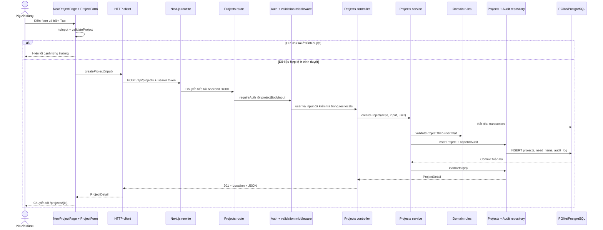

# Đánh giá bài 3, bài 4 và luồng Tạo dự án

**Ngày kiểm tra:** 15/09/2026  
**Phạm vi:** Homework 3A, 3B, 4A và phần tích hợp local của 4B.

## 1. Kết luận hiện tại

Nếu câu hỏi là **mã nguồn đã đáp ứng bài 3A, 3B và 4A chưa**, câu trả lời là **đã đáp ứng phần kỹ thuật chính**. Nếu câu hỏi là **đã sẵn sàng nộp toàn bộ chưa**, câu trả lời là **chưa**, vì nhóm vẫn cần human review, video/minh chứng và một commit cuối chứa đúng trạng thái đã kiểm tra.

| Bài | Kết quả | Bằng chứng hiện có | Phần còn thiếu |
| :-- | :-- | :-- | :-- |
| 3A | Đạt về mã nguồn | Next.js có các màn danh sách, chi tiết, tạo/sửa, hàng chờ; form có validation; có loading, empty, error, success; build thành công | Khanh tự đọc/review code và quay video 60 giây |
| 3B | Đạt về mã nguồn | Có adapter mock cùng contract HTTP; luồng ba vai; 8 test mock và 27 test domain đạt | Video, human review và ghi hash commit dùng để nộp |
| 4A | Đạt về mã nguồn | Express theo module; JWT, Zod, status code, PGlite, migration, transaction, audit append-only, health/log; 16 test HTTP đạt | Human review của An, ảnh/log/request/DB trước-sau và hash commit nộp |
| 4B | Mới đạt phần tích hợp local | Playwright đã chạy luồng FE → BE → DB thật và kiểm tra cả lỗi 422 | Chưa có Docker/cách đóng gói tương đương, deploy hoặc lý do local đầy đủ, video và hồ sơ vận hành |

### Kết quả chạy máy

- `npm.cmd test`: **51/51** — domain 27, backend 16, frontend mock 8.
- `npm.cmd run typecheck`: backend và frontend đều đạt.
- `npm.cmd run build`: Next.js build thành công các route hiện có.
- `npm.cmd run test:e2e`: **1/1** luồng trình duyệt đạt.
- Backend mặc định khởi động ở cổng 4000; `GET /health` trả `{"status":"ok","db":"ok"}`.
- Test backend có trường hợp đóng database, mở lại cùng thư mục rồi đọc được dự án vừa tạo.

Lần khởi động đầu tiên báo lỗi vì nhiều tiến trình backend cũ cùng giữ `.data/pglite`. Sau khi dừng đúng các cây tiến trình đó, cấu hình vẫn giữ đường dữ liệu chuẩn `.data/pglite`; không xóa hay thay thế dữ liệu cũ.

## 2. Luồng chi tiết của chức năng Tạo dự án

Tình huống: Khanh đã đăng nhập, mở `/projects/new`, nhập thông tin hợp lệ rồi bấm **Tạo bản nháp dự án**.



### Bước 1 — Route của Next.js chỉ nối URL với màn hình

`fe/src/app/projects/new/page.tsx` chỉ import và render `NewProjectPage`. File trong `app` không chứa form hay nghiệp vụ. Nhờ vậy URL do Next.js quản lý, còn màn hình nằm đúng module `presentation/modules/projects`.

### Bước 2 — Màn hình điều phối thao tác giao diện

`NewProjectPage.tsx` truyền callback `onSubmit` cho `ProjectForm`. Khi callback nhận được dữ liệu hợp lệ, nó gọi `createProject(input, mode)`. Khi API trả dự án mới, `router.push()` chuyển người dùng sang `/projects/{id}`.

Màn hình chỉ biết **cần tạo dự án và chuyển trang**. Nó không biết JWT được lưu ở đâu, URL backend là gì hay câu SQL nào được chạy.

### Bước 3 — Hook của form quản lý state và validation phía client

`use-project-form.ts` giữ:

- nội dung người dùng đang nhập;
- danh sách thành viên để chọn người phụ trách tài chính;
- trạng thái đang gửi và lỗi mạng;
- lỗi theo từng field.

Khi submit, hook gọi `toInput(form)` để đổi chuỗi từ `<input type="number">` thành số, sau đó gọi quy tắc dùng chung `validateProject`. Nếu sai, request chưa được gửi và focus chuyển tới ô lỗi đầu tiên. Nếu mạng/backend lỗi, nội dung form vẫn được giữ để người dùng thử lại.

Validation ở frontend giúp phản hồi nhanh, nhưng không phải lớp bảo vệ cuối cùng vì client có thể bị bỏ qua hoặc giả mạo.

### Bước 4 — Adapter quyết định dùng mock hay HTTP

`fe/src/libs/api/index.ts` chọn adapter theo `NEXT_PUBLIC_API_MODE`:

- `mock`: chạy prototype bài 3B trong trình duyệt;
- `http`: gọi backend/database thật cho phần tích hợp.

Cả hai adapter triển khai cùng `ApiAdapter`, nên màn hình không phải đổi code khi chuyển chế độ. Trong HTTP adapter, `createProject` trở thành:

```http
POST /api/projects
Content-Type: application/json
Authorization: Bearer <token>
```

### Bước 5 — HTTP client thêm token và quản lý lỗi

`fe/src/libs/api/client.ts` đọc token của session hiện tại, gắn header Bearer, đặt timeout 15 giây và parse JSON. Request ghi dữ liệu không tự retry vì server có thể đã ghi thành công trước khi kết nối bị đứt.

Nếu nhận 401, client xóa session. Nếu người dùng đổi tài khoản trong lúc request đang chạy, `revision` thay đổi và kết quả cũ bị bỏ qua, tránh hiển thị dữ liệu của phiên trước.

### Bước 6 — Next.js chuyển tiếp request

Trình duyệt gọi cùng origin `/api/projects`. `fe/next.config.mjs` rewrite đường này sang `API_ORIGIN`, mặc định là `http://localhost:4000`. Cách này tránh phải hard-code địa chỉ backend trong component và tránh vấn đề CORS khi chạy local.

### Bước 7 — Route backend định nghĩa đúng thứ tự xử lý

Trong `be/src/modules/projects/projects.route.ts`:

```text
POST /api/projects
  → requireAuth
  → projectBodyInput
  → createProject controller
```

Thứ tự quan trọng: request phải có danh tính hợp lệ trước, body phải đúng cấu trúc tiếp theo, rồi controller mới chạy.

### Bước 8 — Auth middleware xác thực JWT

`requireAuth` lấy header `Authorization`, gọi `authenticate`, kiểm chữ ký HS256, issuer, thời hạn và `sub`. Sau đó backend tải user từ DB và đặt vào `res.locals.user`.

Nếu thiếu token: **401 `AUTH_REQUIRED`**. Token sai hoặc hết hạn: **401 `INVALID_TOKEN`**. `coordinatorId` không được lấy từ body; service dùng `user.id` từ token nên client không thể mạo danh người điều phối.

### Bước 9 — Middleware Zod kiểm tra hình dạng request

`projectBodyInput` dùng schema Zod trong `projects.schema.ts` để kiểm kiểu và giới hạn như ngày ISO, UUID, số lượng và số phần tử. Dữ liệu đã parse được đặt vào `res.locals.input`.

Ví dụ `targetQty: "một trăm"` là sai kiểu và nhận **400 `BAD_REQUEST`**. Đây là lỗi cú pháp/hình dạng request, khác với quy tắc nghiệp vụ.

### Bước 10 — Controller chuyển HTTP sang lời gọi nghiệp vụ

`projects.controller.ts` lấy `input` và `currentUser` đã được middleware chuẩn bị, rồi gọi:

```ts
service.createProject(deps, input, user)
```

Controller không truy vấn DB. Khi thành công, controller trả **201 Created**, header `Location: /api/projects/{id}` và JSON `ProjectDetail`.

### Bước 11 — Service sở hữu quy tắc và transaction

`projects.service.ts` mở một transaction. Trong transaction, service:

1. gọi `checkProjectRules` với ngày hiện tại và `user.id`;
2. kiểm BR-002/BR-003 cùng các quy tắc domain;
3. gọi repository tạo dự án và các hạng mục;
4. ghi dòng audit đầu tiên từ `null` sang `draft`.

Lỗi như người giữ tiền chưa xác minh hoặc trùng người điều phối nhận **422 `VALIDATION_FAILED`**. Nếu một INSERT thất bại, transaction rollback nên không tồn tại dự án thiếu hạng mục hoặc thiếu audit.

### Bước 12 — Repository làm việc trực tiếp với database

`projects.repository.ts` ghi bảng `projects`, lấy UUID được DB sinh ra, rồi ghi các dòng `need_items`. `audit.repository.ts` ghi `audit_log`. Repository nhận `tx` từ service nên cả ba nhóm dữ liệu thuộc cùng một transaction.

Các lớp bảo vệ trong DB vẫn hoạt động nếu code có lỗi, ví dụ CHECK không cho `treasurer_id = coordinator_id` và CHECK yêu cầu số lượng mục tiêu lớn hơn 0.

### Bước 13 — Đọc lại dữ liệu và cập nhật UI

Sau khi commit, service gọi `loadDetail` để đọc dự án, hạng mục, người dùng và audit thành một `ProjectDetail`. FE nhận response, chuyển tới trang chi tiết, rồi trang chi tiết tải lại dữ liệu từ API. Điều người dùng thấy vì vậy là dữ liệu đã tồn tại trong DB, không phải bản state tạm của form.

## 3. Bảng lỗi cần nhớ khi trình bày

| Trường hợp | Lớp phát hiện | HTTP |
| :-- | :-- | :-- |
| Thiếu token | Auth middleware | 401 `AUTH_REQUIRED` |
| Token giả/hết hạn | Auth service | 401 `INVALID_TOKEN` |
| Body sai kiểu hoặc ngày không đúng ISO | Zod middleware | 400 `BAD_REQUEST` |
| Dữ liệu đúng kiểu nhưng vi phạm nghiệp vụ | Domain/service | 422 `VALIDATION_FAILED` |
| Lỗi DB hoặc lỗi không dự kiến | Error handler | 500 `INTERNAL`, có request ID |

## 4. Điều cần làm để chốt bài nộp

1. Khanh mở luồng frontend, đọc và giải thích được state, event submit, adapter mock/HTTP và xử lý lỗi.
2. An giải thích được route → middleware → controller → service → repository → DB, đặc biệt transaction và audit.
3. Ghi phát hiện/sửa thực tế vào `docs/ai-usage-log.md`; đây mới là human review của sinh viên.
4. Quay video bài 3 và video main workflow FE–BE–DB theo yêu cầu môn.
5. Chụp output test, `/health`, một request hợp lệ, một request sai và dữ liệu còn sau restart.
6. Dọn thư mục `apps/` cũ sau khi xác nhận không còn mã cần giữ.
7. Chạy lại bốn lệnh kiểm tra, tạo commit cuối và ghi đúng hash/URL vào tài liệu nộp.
